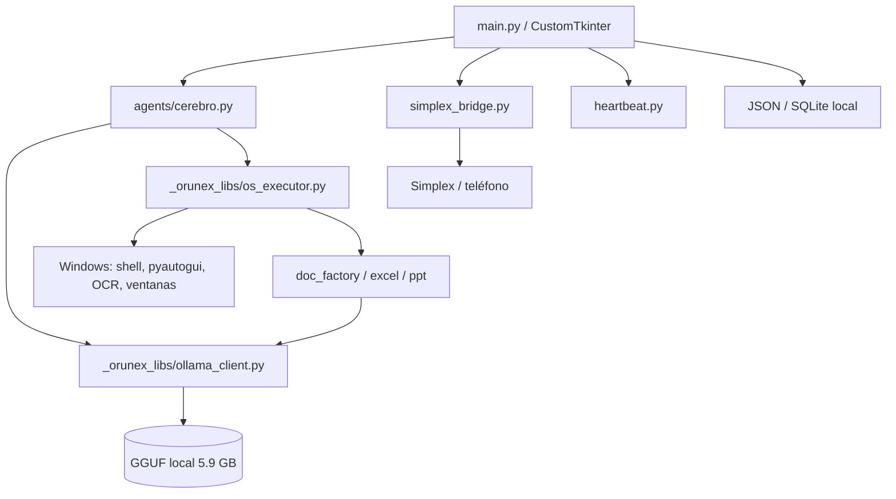

# Auditoría técnica completa — Project_Orunex

**Fecha:** 21 de octubre de 2026  
**Alcance:** 70 archivos Python, configuración, assets, launchers, logs, bases de datos locales y scripts auxiliares.  
**Tipo de revisión:** estática + pruebas de importación + ejecución controlada de módulos no destructivos.  
**Veredicto corto:** hay activos aprovechables (generación de documentos, investigación web, automatización de escritorio y una UI funcional en concepto), pero el proyecto **no es ejecutable ni seguro en su estado actual**. No debe presentarse tal cual a un hackathon. La recomendación es conservar los motores probados como referencia y construir un runtime nuevo, una app de escritorio nueva y una app Android nativa.

---

## 1. Resumen ejecutivo

| Métrica | Valor |
|---|---:|
| Archivos Python | 70 |
| Líneas de Python | 15,014 |
| Archivo más grande | `src/main.py` — 2,348 líneas |
| Tamaño total del proyecto | 5.67 GB |
| Modelo GGUF local | 5.89 GB |
| Archivos totales | 181 |
| Repositorio Git | No existe |
| Tests reales (pytest/CI) | 0 |
| README | No existe |
| Dependencias declaradas | 7 |
| Dependencias de terceros detectadas en imports | 45+ |
| `except:` desnudos | 105 |
| `shell=True` | 18 |
| `subprocess.Popen` | 19 |
| Hardcoded `C:\Users\artur\...` | Sí, en rutas críticas |
| Integración Meta | No existe |

### Lo que sí tiene valor

1. **Motores de artefactos**: `doc_factory.py`, `document_engine.py`, `excel_engine.py`, `excel_master.py` y `ppt_maker.py` contienen lógica real para generar PDF, Word, Excel y PowerPoint. Se pueden rescatar como librerías, quitándoles el acoplamiento al modelo local.
2. **Investigación web**: `headless_web.py` ya intenta buscar, extraer y resumir contenido. La idea es correcta; la implementación debe reescribirse para producir citas verificables.
3. **Automatización de escritorio**: `os_executor.py` tiene más de 1,600 líneas de automatización real (ventanas, OCR, clics, teclado, screenshots). Es valioso como referencia, pero no como módulo de producción.
4. **Concepto de producto**: la combinación “agente que ejecuta en desktop + control remoto desde el teléfono + artefactos” es exactamente el tipo de proyecto que encaja en el hackathon de Meta.
5. **Marca y UI**: existe un logo, una identidad visual y una app de escritorio con flujo de chat, historial, settings y agente. La estética se puede conservar; el código de UI no.

### Lo que impide usarlo hoy

1. **No arranca.** `src/main.py` importa `faster_whisper` en la línea 13 y el paquete no está instalado. El error ocurre antes de cualquier mensaje amigable.
2. **No hay motor de inferencia.** `llama_cpp` no está instalado. `call_ollama()` falla en todas las generaciones.
3. **Faltan casi todas las dependencias.** `requirements.txt` solo declara 7 paquetes; el código importa 45+.
4. **Rutas hardcodeadas a otro usuario.** `ollama_client.py` apunta a `C:\Users\artur\Downloads\...`; el modelo está en `C:\Users\Hp\Downloads\...`.
5. **El launcher está roto.** `Lanzar_Orunex_Windows.vbs` apunta a `C:\Users\artur\...` y a `src\main_av.py`, que no existe.
6. **No hay integración con Meta.** Todo el proyecto depende de un GGUF local, no de Meta Model API.
7. **La seguridad es insuficiente para un agente autónomo.** Acciones peligrosas se aprueban por defecto; hay ejecución de shell con `shell=True`; el sandbox de rutas es vulnerable; el puente Simplex acepta contactos automáticamente y ejecuta comandos remotos.
8. **No hay estado durable.** El planificador vive en memoria; si se cierra la app, la misión se pierde.
9. **No hay tests ni CI.** Los “tests” son scripts de benchmark que imprimen resultados, no una suite reproducible.
10. **No hay repositorio Git.** No se puede auditar historia, revertir cambios ni entregar un diff limpio al hackathon.

---

## 2. Evidencia de ejecución

### 2.1 Entrada principal

```text
python -c "import sys; sys.path.insert(0,'src'); import main"
ModuleNotFoundError: No module named 'faster_whisper'
```

`src/main.py` línea 13:

```python
from faster_whisper import WhisperModel
```

No está dentro de un `try/except`, así que la app muere antes de mostrar la UI.

### 2.2 Automatización de escritorio

```text
python -c "import sys; sys.path.insert(0,'src'); import _orunex_libs.os_executor"
ModuleNotFoundError: No module named 'pyautogui'
```

`os_executor.py` línea 2 importa `pyautogui` de forma directa. Esto bloquea cualquier flujo de automatización.

### 2.3 Dependencias instaladas vs. requeridas

Probado con el Python 3.12.10 del sistema:

| Estado | Paquetes |
|---|---|
| Presentes | `PIL`, `numpy`, `pandas`, `qrcode`, `websocket`, `requests`, `fastapi`, `uvicorn`, `pydantic`, `httpx` |
| Ausentes | `customtkinter`, `pyautogui`, `fpdf`, `docx`, `openpyxl`, `pptx`, `llama_cpp`, `faster_whisper`, `mss`, `pytesseract`, `cv2`, `pyttsx3`, `schedule`, `ddgs`, `bs4`, `psutil`, `win32gui`, `uiautomation`, `moviepy`, `gtts`, `sounddevice`, `pyaudio`, `speech_recognition`, `matplotlib` |

`src/requirements.txt` solo contiene:

```text
customtkinter==5.2.2
pillow==12.1.1
pyautogui==0.9.54
fpdf2==2.8.6
python-docx==1.2.0
opencv-python==4.13.0.92
requests==2.32.5
```

Faltan, entre otros: `llama-cpp-python`, `faster-whisper`, `openpyxl`, `python-pptx`, `mss`, `pywin32`, `ddgs`, `beautifulsoup4`, `pyttsx3`, `schedule`, `websocket-client`, `pytesseract`, `psutil`, `uiautomation`, `moviepy`, `gTTS`, `sounddevice`, `pyaudio`, `SpeechRecognition`, `matplotlib`, `lxml`, `pandas`, `numpy`, `qrcode`, `keyring`, `cryptography`.

### 2.4 Launcher

`Lanzar_Orunex_Windows.vbs`:

```vb
WshShell.CurrentDirectory = "C:\Users\artur\Downloads\Project_Orunex"
WshShell.Run "pythonw.exe src\main_av.py", 1, False
```

Problemas:

- Usuario equivocado (`artur` vs. `Hp`).
- `src\main_av.py` no existe.
- El entry point real es `src/main.py`.
- No hay manejo de errores, logs ni recuperación.

### 2.5 Entorno Android

Sí hay SDK de Android, pero no Android Studio ni `cmdline-tools`:

- SDK: `C:\Users\Hp\AppData\Local\Android\Sdk`
- Plataformas: `android-35`, `android-36`, `android-37.0`
- Build-tools: `35.0.0`, `35.0.1`, `36.0.0`, `37.0.0`
- Emulador: `emulator.exe`
- AVD: `Transportes65`
- `adb`: presente, sin dispositivos conectados
- JDK: Temurin 21.0.12
- Gradle: no instalado globalmente
- Android Studio: no instalado
- `cmdline-tools`: no instalado

Conclusión: se puede compilar Android con **Gradle Wrapper** y el SDK existente, sin Android Studio. Hay que crear el wrapper y configurar `local.properties`.

---

## 3. Hallazgos críticos (P0)

### P0-1. El proyecto no es ejecutable

No arranca por dependencias faltantes. Aunque se instalen, el motor local no está disponible (`llama_cpp` ausente) y la ruta del GGUF es incorrecta. Un jurado no puede probar nada sin un entorno preparado a mano.

**Impacto:** bloquea demo, tests y entrega.  
**Acción:** entorno reproducible con `pyproject.toml`, `uv`/venv, `make dev`, y modo mock sin API key.

### P0-2. No existe integración con Meta

No hay cliente HTTP para Meta Model API, ni manejo de `MODEL_API_KEY`, ni modelos Meta, ni tool calling, ni Responses API, ni computer use. El proyecto usa un GGUF local llamado `Qwythos-9B...`, que además no es un modelo Meta.

**Impacto:** no cumple el requisito central del hackathon.  
**Acción:** crear `core/providers/meta.py` con Meta Model API (`https://api.meta.ai/v1`), modelos Muse, tool calling y fallback mock.

### P0-3. Rutas hardcodeadas y launcher roto

Rutas a `C:\Users\artur\...` en `ollama_client.py`, `main.py` y el `.vbs`. También hay rutas relativas al CWD (`os.getcwd()`) en `permissions.py`, `document_engine.py`, `maintenance.py`, etc. Cambiar el directorio de trabajo cambia dónde se escriben logs, artefactos y permisos.

**Impacto:** el proyecto solo funciona en la máquina y carpeta exactas del autor original.  
**Acción:** configuración central, `Path(__file__)`, workspace del usuario y variables de entorno.

### P0-4. Permisos peligrosos aprobados por defecto

`permissions.py`:

```python
strict_perm = os.environ.get("ORUNEX_STRICT_PERM", "0")
if level == PermLevel.DANGEROUS and strict_perm == "1":
    ...
log_entry(..., status="APPROVED")
return True
```

Es decir: si `ORUNEX_STRICT_PERM` no está definido (el caso normal), `DEL`, `SOCIAL` y cualquier acción marcada como peligrosa se ejecuta sin confirmación.

**Impacto:** un agente autónomo puede borrar archivos o publicar en redes sin aprobación.  
**Acción:** default-deny, aprobación explícita para `DANGEROUS`, timeout de aprobación, auditoría y kill switch.

### P0-5. Ejecución de shell insegura

Hay 18 usos de `shell=True` y 19 `subprocess.Popen`. Ejemplos:

```python
subprocess.run(cmd, shell=True, capture_output=True, text=True, cwd=work_dir, timeout=30)
subprocess.Popen(f"start {target_bin}", shell=True)
subprocess.Popen(cmd_val, shell=True, ...)
```

Los comandos provienen del modelo o del usuario, sin allowlist de binarios, sin parsing de argumentos y sin sandbox. Un prompt malicioso o una página web con instrucciones puede convertirse en ejecución arbitraria.

**Impacto:** RCE local.  
**Acción:** `subprocess.run([bin, *args])`, allowlist de binarios, directorios permitidos, sin shell, timeout, captura de salida y aprobación para escribir/ejecutar.

### P0-6. Sandbox de rutas vulnerable

`os_executor.py` usa:

```python
if safe_d.startswith(base_dir):
if safe_path.startswith(base_dir):
```

`startswith` no es un sandbox: `C:\workspace_evil` empieza con `C:\workspace`. También falla con mayúsculas/minúsculas, symlinks y `..`.

**Impacto:** escritura/lectura fuera del workspace.  
**Acción:** `Path.resolve().is_relative_to(workspace.resolve())`, rechazo de symlinks, allowlist de extensiones.

### P0-7. Simplex ejecuta comandos remotos sin autenticación fuerte

`simplex_bridge.py`:

- `remote_commands: True` por defecto.
- `auto-accept-new-contacts` y `auto-accept-member-contacts` se envían al CLI.
- Cualquier mensaje que no sea un comando conocido se pasa al agente como tarea.
- No hay allowlist de contactos, firma, token ni confirmación.
- `!archivo:` puede exfiltrar archivos de `orunex_outputs`.
- `!captura` envía screenshots.
- `!stop` es el único control de emergencia, pero también lo puede enviar cualquier contacto.

**Impacto:** cualquier contacto puede ejecutar tareas y extraer archivos/pantalla.  
**Acción:** retirar Simplex del MVP; reemplazar por Android + WebSocket con pairing token, TLS y allowlist de dispositivos.

### P0-8. Estado no durable

`project_manager.py` guarda misiones en memoria (`ACTIVE_PROJECT`), con hilos y locks. No hay SQLite, checkpoints, reanudación ni historial. Si la app se cierra o falla un paso, se pierde el contexto.

**Impacto:** no se pueden hacer misiones largas ni demostrar autonomía real.  
**Acción:** runtime con SQLite WAL, eventos append-only, checkpoints y reanudación.

### P0-9. Sin tests, CI ni reproducibilidad

`src/tests/` contiene scripts de benchmark que imprimen resultados y dependen del entorno. No hay `pytest`, fixtures, mocks de API, CI ni cobertura. No hay `pyproject.toml` ni lockfile.

**Impacto:** cada cambio puede romper algo sin que se detecte.  
**Acción:** `pytest` + `pytest-asyncio` + `respx`/`responses`, CI en GitHub Actions, golden missions y smoke tests de UI.

### P0-10. Sin Git

No existe `.git`. No hay historia, ramas, releases ni forma de demostrar qué se construyó durante el hackathon.

**Impacto:** riesgo de elegibilidad y de perder trabajo.  
**Acción:** crear repo, `.gitignore` agresivo (GGUF, DBs, logs, outputs, secretos), commits pequeños y tags.

---

## 4. Hallazgos importantes (P1)

### 4.1 Monolito de UI

`src/main.py` tiene 2,348 líneas y mezcla:

- arranque de app,
- tema y animaciones,
- chat,
- historial,
- settings,
- integraciones,
- Simplex,
- voz,
- visualización,
- ejecución de agentes,
- automatización,
- scheduling.

Consecuencias:

- dos definiciones de `toggle_fullscreen` (líneas 676 y 880),
- dos definiciones de `refresh_ui_text` (líneas 2153 y 2499),
- `self.thinker_model_var` usado en línea 662 sin estar definido,
- `call_ollama(prompt, model=...)` con el orden de argumentos incorrecto,
- errores silenciados por `except:`.

**Acción:** retirar `main.py` como entry point. Nueva UI PySide6 y daemon FastAPI separado.

### 4.2 Orquestación por regex y etiquetas

`cerebro.py` usa `[MAKE_DOC: ppt | ...]`, `[CMD: ...]`, `[FILE: ...]`, etc. `os_executor.py` impone un “Silence-Shield” que limita la cantidad de acciones por respuesta. Es frágil:

- el modelo puede escribir una etiqueta dentro de un texto y disparar una acción,
- no hay JSON schema,
- no hay validación de argumentos,
- no hay dependencias entre pasos,
- no hay idempotencia,
- no hay verificación del resultado.

**Acción:** planner con structured outputs (JSON Schema), tool registry con schemas Pydantic, DAG con dependencias y verifier.

### 4.3 Acoplamiento al modelo local

`ollama_client.py`:

- ruta hardcodeada,
- `llama_cpp` ausente,
- `model` se ignora,
- formato ChatML asumido,
- sin tool calling,
- sin streaming real en la UI,
- `get_local_embedding()` depende de un modelo con embeddings.

`doc_factory.py` y `excel_master.py` llaman a `call_ollama("orunex_v37", ...)`. `excel_master.py` usa `from ollama_client import call_ollama` (import absoluto), que falla si se importa como paquete `_orunex_libs`.

**Acción:** provider abstraction (`MetaProvider`, `LocalProvider`, `MockProvider`); los motores de documentos reciben un `LLMClient` inyectado, no lo importan.

### 4.4 Dependencias pesadas y frágiles

- `torch` + `transformers` para visión local (`vision_engine.py`).
- `undetected_chromedriver` para navegación (`chrome_driver.py`).
- `moviepy` + `gTTS` para video (`video_marketing_engine.py`).
- `pyaudio` + `sounddevice` + `speech_recognition` para voz.
- `llama-cpp-python` para el GGUF (compilación nativa).
- `customtkinter` para UI.

Para un hackathon de 10 días, instalar y empaquetar todo esto es un riesgo. Hay que reducir el stack.

### 4.5 Código muerto o duplicado

- `src/src/` (copia duplicada),
- `src/orunex_outputs/` (artefactos dentro del código),
- `synapse_tester*.py` (5 archivos de tests internos),
- `stt_worker.py` (24 líneas, reemplazable),
- `scratch/` (3 scripts de búsqueda),
- `tmp/` (pruebas de YouTube),
- `resources/` y `scripts/` vacíos,
- `app_developer.py` (981 líneas, fuera del MVP),
- `colab_master.py`, `compute_router.py`, `video_marketing_engine.py`, `whatsapp_master.py`, `social_media.py` (plugins opcionales).

### 4.6 Encoding y textos corruptos

Hay mojibake en docstrings y strings: `�?"`, `�?`, `Compa��a`, `MǸxico`, etc. También emojis que pueden fallar en consolas Windows. Esto afecta UI, PDFs y logs.

**Acción:** UTF-8 en todos los archivos, `PYTHONUTF8=1`, revisar strings, tests de renderizado.

### 4.7 Logs y datos personales

- `src/logs/audit.log` — 1.3 MB.
- `simplex_data/orunex_profile_agent.db` — 2.6 MB.
- `simplex_data/orunex_profile_chat.db` — 1.7 MB.
- `src/orunex_outputs/audit_log.jsonl` — 30 KB.
- `simplex_raw_log.json`.

Pueden contener nombres, contactos, mensajes, rutas y capturas. No deben ir al repo ni al instalador.

### 4.8 Instalador no confiable

`create_installer.py` crea un ZIP embebido en un EXE, lo extrae en un directorio temporal y ejecuta `post_install.bat` con `os.system`. No hay firma, verificación de integridad, ni actualización. No es un instalador profesional.

### 4.9 UI/UX

- Tema oscuro con acentos cyan, pero fuentes y emojis inconsistentes.
- El chat es el centro; no hay vista de misión, DAG, artefactos ni aprobaciones.
- El “copiloto” flotante y las animaciones consumen recursos.
- No hay accesibilidad, ni escalado DPI robusto, ni i18n consistente.
- El estado se muestra en un log, no en un modelo de misión.

---

## 5. Arquitectura actual (como está)



Problemas estructurales:

- La UI es el orquestador.
- El modelo local es el único proveedor.
- Las herramientas se ejecutan por etiquetas de texto.
- El estado no es durable.
- La seguridad es global y opcional.
- No hay separación entre “daemon”, “UI” y “cliente móvil”.

---

## 6. Inventario archivo por archivo

**Leyenda de decisión:**

- **SALVAR**: lógica reutilizable con refactor moderado.
- **REESCRIBIR**: la idea sirve, el código no.
- **PARK**: plugin opcional fuera del MVP; no borrar, pero no invertir ahora.
- **RETIRAR**: código muerto, peligroso o reemplazado.

### 6.1 Entrada y agentes

| Archivo | LOC | Rol | Estado | Decisión |
|---|---:|---|---|---|
| `src/main.py` | 2,348 | App CustomTkinter, chat, settings, ejecución | No arranca; monolito; duplicados; rutas hardcodeadas | **REESCRIBIR** |
| `src/agents/cerebro.py` | 457 | Intención + prompt + etiquetas | Funciona aislado; frágil; regex | **REESCRIBIR** (conservar ejemplos de intención) |
| `src/agents/supervisor.py` | 20 | Routing por keywords | Trivial; no aporta | **RETIRAR** |
| `src/agents/universal.py` | 36 | Wrapper de cerebro + voz | Duplica routing; depende de especialista | **RETIRAR** |
| `src/agents/__init__.py` | 6 | Export de cerebro | Acopla import | **RETIRAR** (nuevo paquete) |
| `src/trigger_mission.py` | 25 | CLI de prueba | Hardcodea misión y duerme 3 s | **REESCRIBIR** como CLI real |

### 6.2 Librerías núcleo

| Archivo | LOC | Rol | Estado | Decisión |
|---|---:|---|---|---|
| `src/_orunex_libs/__init__.py` | 0 | Paquete | Vacío | Mantener |
| `animation.py` | 13 | Fade de widgets | Solo CTk | **RETIRAR** |
| `app_developer.py` | 981 | Genera apps Python completas | Grande, fuera de alcance, calidad variable | **PARK** |
| `app_integrations_manager.py` | 177 | Detecta Chrome/Office/VSCode | Útil para settings | **PARK** |
| `app_integrator.py` | 220 | Hooks de apps | Windows-specific | **PARK** |
| `audit_logger.py` | 36 | JSONL de interacciones | Concepto válido; sin hash chain | **REESCRIBIR** |
| `auto_healer.py` | 81 | Heurísticas de reparación | Regex; puede empeorar | **REESCRIBIR** como retry/repair policy |
| `automation_daemon.py` | 149 | Tareas programadas | Estado en memoria | **REESCRIBIR** |
| `chrome_driver.py` | 147 | Chrome stealth/YouTube | `undetected_chromedriver`; frágil | **RETIRAR** (Playwright) |
| `colab_master.py` | 167 | Genera notebooks Colab | Fuera del MVP | **PARK** |
| `compute_router.py` | 151 | Decide local/Colab | No aplica al nuevo stack | **RETIRAR** |
| `config_manager.py` | 46 | JSON config | Sin schema; sync raro | **REESCRIBIR** (Pydantic Settings) |
| `database.py` | 53 | Memoria SQLite | Esquema mínimo | **REESCRIBIR** |
| `doc_factory.py` | 515 | PDF/Word/Excel/landing | Lógica real; acoplada al LLM local | **SALVAR** |
| `document_engine.py` | 361 | PDF/DOCX/PPTX/XLSX/CSV/MD | Útil; salida básica | **SALVAR** |
| `excel_engine.py` | 292 | Formato/fórmulas Excel | Útil | **SALVAR** |
| `excel_master.py` | 694 | Excel avanzado + VBA | Potente; import absoluto roto; warning | **SALVAR** selectivo |
| `headless_web.py` | 140 | Búsqueda/extracción/resumen | Sin citas; scraping frágil | **REESCRIBIR** |
| `heartbeat.py` | 136 | Tareas periódicas desde Markdown | Sin persistencia | **REESCRIBIR** |
| `knowledge_processor.py` | 77 | Ingesta de archivos | Básico | **PARK** |
| `languages.py` | 461 | Diccionarios i18n | Útil | **SALVAR** |
| `long_term_memory.py` | 89 | Memoria JSON | Sin schema | **REESCRIBIR** |
| `maintenance.py` | 34 | Rotación de logs/health | Concepto | **SALVAR** (concepto) |
| `memory_gc.py` | 80 | Compacta historial | Concepto | **SALVAR** (concepto) |
| `motion_engine.py` | 58 | CSS/motion HTML | No aplica | **RETIRAR** |
| `office_integrator.py` | 139 | COM Office | Útil para Excel/Word | **SALVAR** (Windows) |
| `ollama_client.py` | 108 | GGUF local | Ruta rota; sin tool calling | **REESCRIBIR** (provider Meta + fallback) |
| `orunex_evolve.py` | 35 | Auto-evolución | Sin control | **RETIRAR** |
| `os_executor.py` | 1,655 | Automatización OS | Valioso pero inseguro; 18 shell=True | **REESCRIBIR** en tools pequeños |
| `permissions.py` | 94 | Permisos + audit | Default peligroso | **REESCRIBIR** |
| `ppt_maker.py` | 673 | PPT profesional | Útil; acoplado | **SALVAR** |
| `project_manager.py` | 222 | DAG en memoria | Sin persistencia | **REESCRIBIR** |
| `self_evolver.py` | 215 | Parchea su propio código | Muy peligroso | **RETIRAR** |
| `semantic_search.py` | 107 | Embeddings locales | Depende del GGUF | **REESCRIBIR** / **PARK** |
| `simplex_bridge.py` | 685 | Mensajería remota | Auto-accept + comandos remotos | **RETIRAR** |
| `skills_registry.py` | 37 | Prompts de dominio | Útil como knowledge | **SALVAR** |
| `stt_worker.py` | 24 | Faster-Whisper subprocess | Reemplazable por Voice Transcribe | **RETIRAR** |
| `synapse_mock_tester.py` | 43 | Test interno | No es pytest | **RETIRAR** |
| `synapse_tester.py` | 65 | Test interno | No es pytest | **RETIRAR** |
| `synapse_tester_b.py` | 64 | Test interno | No es pytest | **RETIRAR** |
| `synapse_tester_c.py` | 101 | Test interno | No es pytest | **RETIRAR** |
| `synapse_tester_d.py` | 98 | Test interno | No es pytest | **RETIRAR** |
| `theme.py` | 30 | Cambio de tema | CTk | **RETIRAR** |
| `ui_engine.py` | 97 | HTML/CSS glass | No aplica | **RETIRAR** |
| `uia_engine.py` | 23 | Click UIA | Útil | **SALVAR** |
| `video_marketing_engine.py` | 277 | Video con moviepy/gTTS | Pesado; fuera del MVP | **PARK** |
| `vision_engine.py` | 106 | Modelo de visión local | torch/transformers; pesado | **REESCRIBIR** (SAM/Muse) |
| `web_search.py` | 17 | Wrapper de búsqueda | Duplicado | **RETIRAR** |
| `whatsapp_master.py` | 67 | WhatsApp | Automatización frágil | **PARK** |

### 6.3 Integraciones y widgets

| Archivo | LOC | Rol | Estado | Decisión |
|---|---:|---|---|---|
| `src/integrations/social_media.py` | 96 | Publicar en redes | Sin OAuth robusto | **PARK** |
| `src/integrations/vscode_integration.py` | 232 | Abrir/ejecutar VS Code | Windows; útil como plugin | **PARK** |
| `src/integrations/__init__.py` | 0 | Paquete | Vacío | Mantener |
| `src/widgets/automagic.py` | 216 | Canvas animado | Decorativo | **RETIRAR** |
| `src/widgets/copiloto.py` | 436 | Copiloto flotante | Acoplado a CTk/OS | **RETIRAR** (concepto a nuevo UI) |

### 6.4 Tests y scratch

| Archivo | LOC | Rol | Estado | Decisión |
|---|---:|---|---|---|
| `src/tests/integrity_check_v12.py` | 56 | Auditoría de imports | No pytest | **RETIRAR** |
| `src/tests/sovereign_validator_v12.py` | 106 | Validaciones ad hoc | No pytest | **RETIRAR** |
| `src/tests/test_autonomy_v51.py` | 231 | Benchmark de autonomía | No pytest; ejecuta OS | **RETIRAR** |
| `src/tests/test_v50_suite.py` | 193 | Suite ad hoc | No pytest | **RETIRAR** |
| `src/tests/test_v52_all.py` | 96 | Verificación de features | No pytest | **RETIRAR** |
| `src/tests/zenith_benchmark_v15.py` | 132 | Benchmark | No pytest | **RETIRAR** |
| `src/tests/zenith_benchmark_v16.py` | 125 | Benchmark | No pytest | **RETIRAR** |
| `src/scratch/find_ollama_lines.py` | 6 | Script one-off | Desechable | **RETIRAR** |
| `src/scratch/search_ollama_refs.py` | 27 | Script one-off | Desechable | **RETIRAR** |
| `src/scratch/search_runners.py` | 30 | Script one-off | Desechable | **RETIRAR** |

### 6.5 Archivos no Python

| Archivo | Rol | Decisión |
|---|---|---|
| `src/requirements.txt` | 7 dependencias | **REESCRIBIR** con `pyproject.toml` + lock |
| `src/orunex_config.json` | Config de engine/voz | **REESCRIBIR** (Pydantic, sin secretos) |
| `config/simplex.json` | Config Simplex | **RETIRAR** |
| `src/config/simplex.json` | Duplicado | **RETIRAR** |
| `simplex_data/*.db` | Contactos/chats | **PURGAR** y agregar a `.gitignore` |
| `simplex_bin/*` | CLI/QR | **RETIRAR** del repo |
| `src/logs/audit.log` | 1.3 MB de logs | **PURGAR** y rotar |
| `src/orunex_outputs/*` | Artefactos generados | **IGNORAR** |
| `orunex_outputs/*` | Artefactos generados | **IGNORAR** |
| `Qwythos-*.gguf` | Modelo local 5.9 GB | **NO COMMIT**; fallback opcional |
| `Orunex.Modelfile`, `Orunex_Pro.Modelfile`, `orunex_modelfile` | Configs Ollama | **RETIRAR** |
| `Lanzar_Orunex_Windows.vbs` | Launcher roto | **REEMPLAZAR** |
| `create_installer.py` | Instalador ZIP/EXE | **REESCRIBIR** (PyInstaller/Inno Setup) |
| `heartbeat_tasks.md` | Tareas programadas | **SALVAR** (concepto) |
| `src/assets/logo.png` | Logo | **SALVAR** |
| `orunex.jpg` | Branding | **SALVAR** |
| `crop_btn.py`, `find_blue_btn.py`, `find_guest_btn.py` | Scripts de coordenadas | **RETIRAR** |
| `tmp_scan.py`, `tmp_scan_out.txt`, `test_vscode.py`, `ws_sniffer.py` | Scripts temporales | **RETIRAR** |
| `simplex_raw_log.json`, `test_res.txt` | Logs de prueba | **PURGAR** |
| `resources/`, `scripts/` | Vacíos | Reutilizar para assets/scripts |

---

## 7. Seguridad: modelo de amenazas actual

| Amenaza | Vector | Estado | Mitigación requerida |
|---|---|---|---|
| Ejecución arbitraria | `[CMD:]` + `shell=True` | Alta | allowlist, args, sin shell |
| Borrado de archivos | `[DEL:]` sin aprobación | Alta | default-deny + approval |
| Path traversal | `startswith(base_dir)` | Alta | `Path.is_relative_to` |
| Exfiltración de archivos | Simplex `!archivo` | Alta | retirar Simplex; tokens |
| Captura de pantalla remota | Simplex `!captura` | Alta | consentimiento + allowlist |
| Comandos remotos no autenticados | Simplex auto-accept | Alta | pairing + TLS + device allowlist |
| Prompt injection web | Páginas maliciosas | Media | separar contenido, no seguir instrucciones, verifier |
| Auto-modificación | `self_evolver.py` | Alta | retirar |
| Fuga de API key | logs/config | Media | keyring, redacción |
| Datos personales en repo | DBs/logs | Alta | `.gitignore`, purga |
| Dependencias sin pin | supply chain | Media | lockfile, hashes, CI |
| Acciones sin trazabilidad | audit parcial | Media | audit hash chain, mission events |

---

## 8. Qué conservar, qué reescribir y qué retirar

### Conservar como base (refactor)

- `doc_factory.py`, `document_engine.py`, `excel_engine.py`, `excel_master.py`, `ppt_maker.py`.
- `headless_web.py` (solo la idea; reescribir con citas).
- `uia_engine.py`, `office_integrator.py` (Windows).
- `languages.py`, `skills_registry.py`.
- `maintenance.py`, `memory_gc.py` (conceptos).
- Logo, branding y ejemplos de UI.

### Reescribir desde cero

- Runtime de misión (`planner`, `executor`, `verifier`, `budget`, `approvals`).
- Provider Meta.
- Tool registry + tools.
- Persistencia SQLite.
- API/WebSocket.
- Desktop PySide6.
- Android Kotlin/Compose.
- Seguridad, auditoría, tests, packaging.

### Retirar del producto

- `main.py` como entry point.
- `simplex_bridge.py` y todo Simplex.
- `self_evolver.py`, `orunex_evolve.py`.
- `synapse_tester*.py`.
- `stt_worker.py`.
- `chrome_driver.py` (reemplazar por Playwright).
- `video_marketing_engine.py`, `colab_master.py`, `compute_router.py`, `app_developer.py` (park).
- `app_integrator.py`, `app_integrations_manager.py`, `whatsapp_master.py`, `social_media.py` (park).
- `ui_engine.py`, `motion_engine.py`, `animation.py`, `theme.py`.
- `widgets/copiloto.py`, `widgets/automagic.py`.
- `src/scratch/`, `src/tests/` actuales, `tmp/`.

---

## 9. Conclusión

`Project_Orunex` es un prototipo ambicioso con una cantidad sorprendente de funcionalidad escrita a mano. Tiene tres activos reales: **generación de documentos**, **automatización de escritorio** y **una visión de producto** que combina desktop y móvil. Pero también tiene problemas estructurales que no se arreglan con “instalar dependencias”:

- no hay integración Meta,
- no hay runtime durable,
- no hay seguridad,
- no hay tests,
- no hay build reproducible,
- no hay app Android,
- y la UI es un monolito.

La estrategia correcta no es “parchar” `main.py`. Es **construir un producto nuevo alrededor de los motores que ya funcionan**, con una arquitectura de daemon + desktop + Android, un runtime de misiones verificable y Meta Model API como cerebro. Los detalles están en:

- [`PLAN_MAESTRO.md`](PLAN_MAESTRO.md)
- [`TRES_MISIONES_COMPLEJAS.md`](TRES_MISIONES_COMPLEJAS.md)
