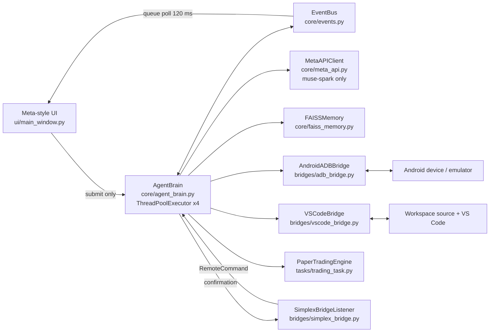

# Orunex — Muse Spark Autonomous Agent

Architecture for the **Meta Global AI Developer Hackathon**. Every reasoning,
multimodal-analysis and decision step is performed by the Meta API model
**`muse-spark`** through `core/meta_api.py`. There is no other LLM anywhere in
this package:

- FAISS embeddings are a deterministic feature-hashing vectorizer (storage and
  recall only, not a model);
- ADB, VS Code and Simplex bridges move bytes/commands only;
- paper-trading arithmetic only *enforces* risk limits that Muse must respect.

## System map



## Task 1 — Android ⇄ Laptop autonomous bugfix

```text
[MuseSpark Brain] -> [ADB Bridge]      screencap (+ focus, UI tree, logcat)
[ADB Bridge] -> [Meta API]             screenshot bytes
[Meta API] -> [FAISS Match]            diagnosis JSON {component, search_query, ...}
[FAISS Match] -> [Meta API]            top-5 candidate source chunks
[Meta API] -> [VS Code]                {file, replacements[]} — file must be a FAISS hit
[VS Code] -> [ADB Bridge]              backup + atomic patch + diff, open editor
[ADB Bridge] -> [Meta API]             rebuild/install/restart + new screenshot
[Meta API] -> [FAISS Memory]           verification verdict, episode stored
```

Entry points: UI button, a Simplex `!fix …` command, or a voice instruction
transcribed by Orunex Live and passed as `BugfixRequest.instruction`.

Safety: patches are exact search/replace pairs (each search must occur exactly
once), paths are confined to the workspace, extensions are allow-listed, a
timestamped backup is written before any change, and auto-apply is off unless
`AGENT_AUTO_APPLY_FIXES=true`.

## Task 2 — TradingView operative via Simplex (paper trading)

```text
[Simplex] -> [MuseSpark Brain]         TradingView alert / remote order
[MuseSpark Brain] -> [FAISS Memory]    recall stored strategies
[FAISS Memory] -> [Meta API]           Muse decision JSON (chart image optional)
[Meta API] -> [Paper Trading]          BUY/SELL/HOLD/REJECT + SL/TP + confidence
[Paper Trading] -> [Simplex]           PAPER ORDER CONFIRMED … (never real funds)
```

Hard gates after Muse decides: confidence threshold, coherent
stop-loss/take-profit geometry, position sizing from the risk budget
(`MAX_RISK_PER_TRADE_PCT`, `MAX_POSITION_PCT`), and a kill switch
(`!stop` on Simplex or the UI toggle). There is deliberately **no** real
broker integration.

## Files

| File | Responsibility |
|---|---|
| `app.py` | Entry point: UI, `--check`, `--index-code`, `--demo-paper` |
| `core/config.py` | `.env` settings + validation (secrets never logged) |
| `core/events.py` | Thread-safe event bus, stage logging |
| `core/meta_api.py` | Unified Muse Spark client (text, vision, JSON decisions) |
| `core/faiss_memory.py` | FAISS namespaces: `code`, `strategy`, `episode` |
| `core/agent_brain.py` | Multithreaded orchestrator + Simplex routing |
| `bridges/adb_bridge.py` | `AndroidADBBridge`: screencap/tap/force-stop/launch/install |
| `bridges/vscode_bridge.py` | Guarded patches, VS Code open, Gradle build |
| `bridges/simplex_bridge.py` | `SimplexBridgeListener` (CLI WebSocket protocol, port 5227) |
| `tasks/bugfix_task.py` | Task 1 pipeline |
| `tasks/trading_task.py` | Task 2 pipeline + paper broker |
| `ui/main_window.py` | Meta-style CustomTkinter UI (non-blocking) |
| `tests_hackathon/test_agent.py` | 8 offline unit tests (fakes for Meta/ADB) |

## Run

```powershell
pip install -r requirements-hackathon.txt
Copy-Item .env.example .env   # then set META_API_KEY
python app.py --check         # diagnostics, no GUI/device needed
python app.py --index-code    # build the FAISS code index
python app.py                 # desktop UI
python -m unittest discover -s tests_hackathon -v
```

Device flow needs `adb` (Android platform-tools) and a device/emulator;
TradingView flow needs the Simplex Chat CLI running with its WebSocket API
(`simplex-chat -p 5227`). If your Meta tenant exposes the deployment name as
`muse-spark-1.3`, set `META_MODEL=muse-spark-1.3` — still Muse Spark, and
the client rejects any non-Muse model.

## Demo script (3 minutes)

Rehearsal (verified on the real emulator, AVD `Transportes65`):

```powershell
python scripts\prepare_hackathon_demo.py start-emulator
python scripts\prepare_hackathon_demo.py plant-bug   # Send -> Sned, rebuild, install
python scripts\prepare_hackathon_demo.py seed        # FAISS code + strategies
python scripts\prepare_hackathon_demo.py status      # everything green?
python app.py
```

1. Show the emulator: the blue button visibly says **Sned**.
2. In the UI press **Capture → Diagnose → Fix (Live)** (instruction and
   auto-apply are pre-filled) and follow the console chain:
   diagnosis → FAISS Match → patch in VS Code → Gradle rebuild → install →
   restart → Muse verification `fixed=true` (~70 s total).
3. Send the pre-filled TradingView alert with **Analyse with Muse → Paper
   Order** and show **PAPER ORDER CONFIRMED** with SL/TP and position sizing.
4. Start the Simplex listener, send `!stop` from the phone, and show the
   kill switch halting paper trading.
5. Afterwards restore the clean app with
   `python scripts\prepare_hackathon_demo.py reset`.

If the emulator is closed, the ADB bridge auto-starts the configured AVD
(`ANDROID_AVD`) and waits for boot — no manual step needed.
