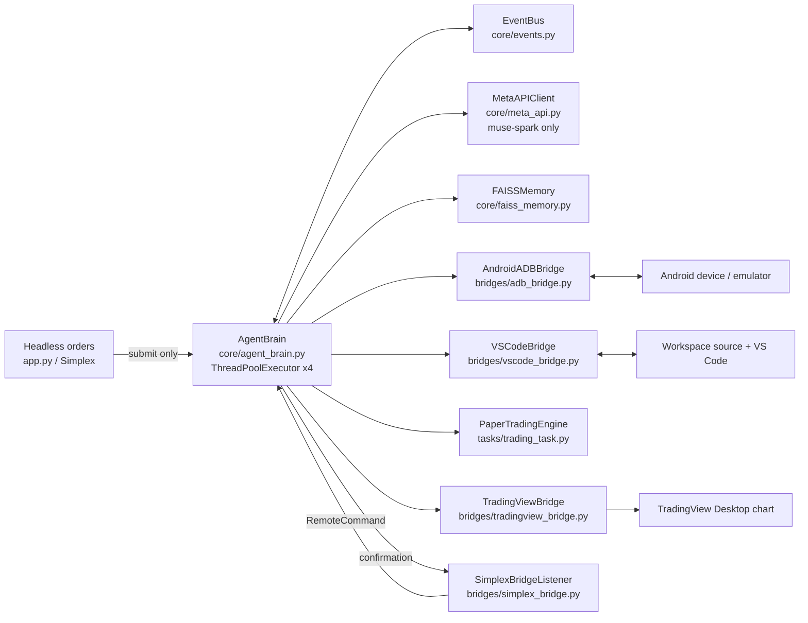

# Orunex — Muse Spark Autonomous Agent

Architecture for the **Meta Global AI Developer Hackathon**. Every reasoning,
multimodal-analysis and decision step is performed by the Meta API model
**`muse-spark`** through `core/meta_api.py`. There is no other LLM anywhere in
this package:

- FAISS embeddings are a deterministic feature-hashing vectorizer (storage and
  recall only, not a model);
- ADB, VS Code and Simplex bridges move bytes/commands only;
- paper-trading arithmetic only *enforces* risk limits that Muse must respect.

## System map



## Task 1 — Android ⇄ Laptop autonomous bugfix

```text
[MuseSpark Brain] -> [ADB Bridge]      screencap (+ focus, UI tree, logcat)
[ADB Bridge] -> [Meta API]             screenshot bytes
[Meta API] -> [FAISS Match]            diagnosis JSON {component, search_query, ...}
[FAISS Match] -> [Meta API]            top-5 candidate source chunks
[Meta API] -> [VS Code]                {file, replacements[]} — file must be a FAISS hit
[VS Code] -> [ADB Bridge]              backup + atomic patch + diff, open editor
[ADB Bridge] -> [Meta API]             rebuild/install/restart + new screenshot
[Meta API] -> [FAISS Memory]           verification verdict, episode stored
```

Entry points: a Simplex `!fix …` command, `python app.py --command`, or a
voice instruction transcribed by Orunex Live and passed as
`BugfixRequest.instruction`.

Safety: patches are exact search/replace pairs (each search must occur exactly
once), paths are confined to the workspace, extensions are allow-listed, a
timestamped backup is written before any change, and auto-apply is off unless
`AGENT_AUTO_APPLY_FIXES=true` or the user issues an explicit Simplex fix order.

## Task 2 — TradingView operative via Simplex (paper trading)

```text
[Simplex] -> [MuseSpark Brain]         !trade + TradingView alert / remote order
[MuseSpark Brain] -> [TradingView]     installed desktop app opens the symbol chart
[TradingView] -> [Meta API]            chart-window capture for Muse (best effort)
[MuseSpark Brain] -> [FAISS Memory]    recall stored strategies (parallel with chart)
[FAISS Memory] -> [Meta API]           Muse decision JSON: BUY/SELL/HOLD/REJECT
[Meta API] -> [Paper Trading]          risk gate + SL/TP + duplicate-exposure guard
[Paper Trading] -> [Simplex]           instant ACK + PAPER ORDER CONFIRMED (never real funds)
```

Hard gates after Muse decides: confidence threshold, coherent
stop-loss/take-profit geometry, position sizing from the risk budget
(`MAX_RISK_PER_TRADE_PCT`, `MAX_POSITION_PCT`), and a kill switch
(`!stop` on Simplex). There is deliberately **no** real
broker integration.

Remote orders (Simplex or UI):

```text
!fix <instruction>       open emulator, diagnose, patch, rebuild, verify, reply
!trade <alert JSON>      open TradingView, Muse decides, paper order with SL/TP
!tv BTCUSDT 1h           open only the TradingView chart
!warmup                  pre-open emulator + TradingView in the background
!status                  agent snapshot
!stop                    kill switch for paper trading
```

Natural-language messages without a verb are still routed by Muse Spark.
Explicit verbs are dispatched locally so the agent starts moving immediately;
all diagnosis and trading decisions remain with Muse.

Latency note: literal zero latency is impossible because Muse API calls,
Gradle and a cold emulator boot take real time.  The implementation removes
avoidable waiting instead: warm-up pre-opens both apps, ADB capture and FAISS
refresh run in parallel, TradingView opens while FAISS recalls strategies, and
explicit Simplex verbs skip the extra routing call.

## Files

| File | Responsibility |
|---|---|
| `app.py` | Entry point: UI, `--check`, `--index-code`, `--demo-paper` |
| `core/config.py` | `.env` settings + validation (secrets never logged) |
| `core/events.py` | Thread-safe event bus, stage logging |
| `core/meta_api.py` | Unified Muse Spark client (text, vision, JSON decisions) |
| `core/faiss_memory.py` | FAISS namespaces: `code`, `strategy`, `episode` |
| `core/agent_brain.py` | Multithreaded orchestrator + Simplex routing |
| `bridges/adb_bridge.py` | `AndroidADBBridge`: screencap/tap/force-stop/launch/install |
| `bridges/vscode_bridge.py` | Guarded patches, VS Code open, Gradle build |
| `bridges/simplex_bridge.py` | `SimplexBridgeListener` (CLI WebSocket protocol, port 5227) |
| `bridges/tradingview_bridge.py` | `TradingViewBridge`: launch/focus desktop app, open symbol, capture chart |
| `tasks/bugfix_task.py` | Task 1 pipeline |
| `tasks/trading_task.py` | Task 2 pipeline + paper broker |
| `tests_hackathon/test_agent.py` | 8 offline unit tests (fakes for Meta/ADB) |

## Run

```powershell
pip install -r requirements-hackathon.txt
Copy-Item .env.example .env   # then set META_API_KEY
python app.py --check         # diagnostics, no GUI/device needed
python app.py --index-code    # build the FAISS code index
python app.py --command "!fix ..."  # headless agent order (no Muse Agent panel)
python -m unittest discover -s tests_hackathon -v
```

Device flow needs `adb` (Android platform-tools) and a device/emulator;
TradingView flow needs the Simplex Chat CLI running with its WebSocket API
(`simplex-chat -p 5227`). If your Meta tenant exposes the deployment name as
`muse-spark-1.3`, set `META_MODEL=muse-spark-1.3` — still Muse Spark, and
the client rejects any non-Muse model.

## Demo script (3 minutes)

Rehearsal (verified on the real emulator, AVD `Transportes65`):

```powershell
python scripts\prepare_hackathon_demo.py start-emulator
python scripts\prepare_hackathon_demo.py reset-paper  # clean $10k paper account
python scripts\prepare_hackathon_demo.py plant-bug   # plant demo defect, rebuild, install
python scripts\prepare_hackathon_demo.py seed        # FAISS code + strategies
python scripts\prepare_hackathon_demo.py status      # everything green?
```

Use this launcher (ANGLE + cold boot, no snapshot); the host's GPU-auto +
snapshot combination was unstable.  If the paper account already has an open
order, Muse may correctly HOLD the same alert to respect exposure, so
`reset-paper` is part of demo preparation.

1. Show the emulator: the blue button visibly contains the demo typo.
2. Send `!fix <instruction>` through Simplex (or rehearse with
   `python app.py --command "!fix ..."`) and follow the chain:
   diagnosis → FAISS Match → exact evidence → patch in VS Code → Gradle
   rebuild → install → restart → Muse verification `fixed=true`
   (~60–100 s total).
3. Send `!trade <alert JSON>` through Simplex and show TradingView opening
   the symbol plus **PAPER ORDER CONFIRMED** with SL/TP and sizing.
4. Start the Simplex listener, wait until the status shows `connected` (~5 s
   history-suppression window), then send `!stop` from the phone and show the
   kill switch halting paper trading.
5. Afterwards restore the clean app with
   `python scripts\prepare_hackathon_demo.py reset`; run `reset-paper` again
   before the next rehearsal.

If the emulator is closed, the ADB bridge auto-starts the configured AVD
(`ANDROID_AVD`) and waits for boot — no manual step needed.
