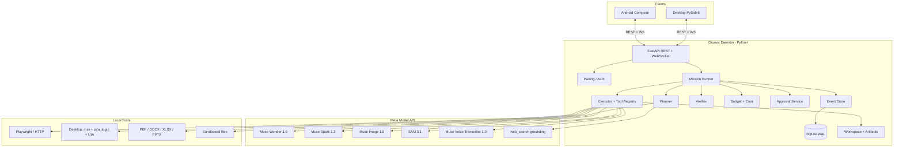
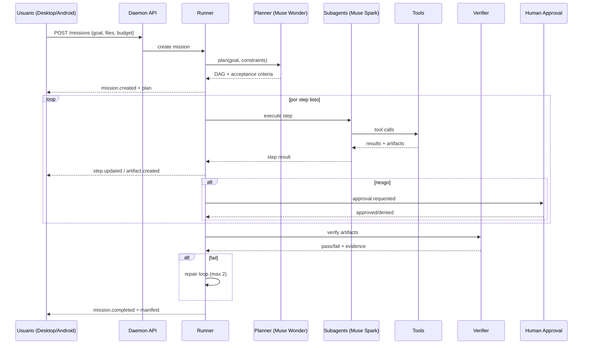

# Plan maestro — Orunex Mission Control

**Versión:** 1.0  
**Fecha:** 21 de octubre de 2026  
**Objetivo:** convertir `Project_Orunex` en un agente autónomo real, potenciado por Meta Model API, con una app de escritorio profesional y una app Android nativa, listo para el **Meta Global AI Developer Hackathon** (26 de octubre – 4 de noviembre de 2026).

---

## 1. Decisión ejecutiva

No se debe “arreglar” `src/main.py`. Se debe construir un producto nuevo alrededor de los motores que ya funcionan.

### Producto

**Orunex Mission Control** es un agente autónomo que recibe un objetivo en lenguaje natural, lo descompone en un plan verificable, ejecuta herramientas en el escritorio, opera aplicaciones reales cuando hace falta, genera artefactos profesionales y pide aprobación humana antes de acciones de riesgo. El usuario puede lanzar, monitorear y aprobar misiones desde Windows o desde Android.

### Frase de pitch

> “Orunex convierte una frase en un paquete de trabajo terminado: investiga, opera tu escritorio, genera los archivos y te pide aprobación desde el teléfono. No es un chatbot; es un operador autónomo con auditoría.”

### Por qué encaja en el hackathon

- Usa **Muse Wonder** para planificación de largo horizonte y computer use.
- Usa **Muse Spark 1.3** para subagentes, extracción y bucles de herramientas.
- Usa **Muse Image** para visuals de los entregables.
- Usa **SAM 3.1** para grounding visual de pantalla y documentos.
- Usa **Muse Voice Transcribe** para comandos de voz y reuniones.
- Usa **search grounding** nativo de Meta con citas.
- Resuelve un problema real de productividad, no un demo artificial.
- Tiene un componente de escritorio + móvil que se ve y se toca.

### Stack recomendado

| Capa | Tecnología | Razón |
|---|---|---|
| Runtime | Python 3.12 + FastAPI + Pydantic 2 | Ecosistema de automatización y documentos; tipado; rápido de iterar |
| Persistencia | SQLite WAL + JSONL de eventos | Cero infraestructura; durable; portable |
| Modelos | Meta Model API (`https://api.meta.ai/v1`) | Requisito del hackathon; Muse + SAM + Voice |
| Desktop | PySide6 (Qt 6) | UI profesional, estable, empaquetable con PyInstaller |
| Android | Kotlin + Jetpack Compose | Nativo, rendimiento, SDK ya instalado |
| Comunicación | REST + WebSocket | Streaming de eventos, approvals, artefactos |
| Empaquetado | PyInstaller + Inno Setup; Gradle | Instalador Windows y APK/AAB |
| Tests | pytest, pytest-asyncio, respx, pytest-qt | Reproducibilidad y CI |

### Lo que se conserva del proyecto actual

- Motores de PDF, Word, Excel y PowerPoint (`doc_factory`, `document_engine`, `excel_engine`, `excel_master`, `ppt_maker`), refactorizados como librerías sin dependencia del LLM.
- Automatización de escritorio (`os_executor`), reescrita en tools pequeños y seguros.
- `uia_engine`, `office_integrator` para Windows.
- `languages.py`, `skills_registry.py`; el sistema de marca se reemplaza por el nuevo `docs/ui/` (mark orbital, tokens y mockups).
- La idea de “misión” y de “artefactos”, no la implementación actual.
- La idea de un canal remoto E2E, reescrita como **Orunex Link** sobre Simplex: emparejamiento explícito, allowlist, comandos cerrados, approvals y auditoría. Simplex deja de ser una puerta de ejecución y pasa a ser un canal opcional de valor añadido.

### Lo que se retira

- `main.py` como entry point.
- La implementación actual de `simplex_bridge.py` (auto-accept, comandos libres, exfiltración). Se reescribe como `OrunexLinkService` seguro; Simplex se conserva como transporte opcional.
- `self_evolver.py`, `orunex_evolve.py`.
- `synapse_tester*.py`, `stt_worker.py`.
- `chrome_driver.py` (se reemplaza por Playwright).
- `app_developer.py`, `colab_master.py`, `compute_router.py`, `video_marketing_engine.py`, `whatsapp_master.py`, `social_media.py` (fuera del MVP).
- `src/scratch/`, `src/tests/` actuales, `tmp/`.

---

## 2. Contexto del hackathon

### Fechas

- **Aplicaciones:** abiertas hasta el **25 de octubre de 2026**.
- **Hackathon:** **26 de octubre – 4 de noviembre de 2026**.
- **Formato:** virtual, mundial, gratis si eres seleccionado.
- **Premios:** $1,000,000; dos tracks: **Indie developer** y **Startup**.
- **Modelos:** Muse Spark, Muse Image, SAM 3.1 vía Meta Model API; modelos open-weight; Muse Code para desarrollo.

### Criterios de jurado (según la página del evento)

- **Indie:** creatividad, ambición técnica y si funciona.
- **Startup:** ejecución técnica y si aguanta producción.

### Implicación para el diseño

No basta con un chat bonito. Hay que demostrar:

1. **Impacto:** un problema caro y repetitivo que el agente resuelve de punta a punta.
2. **Uso profundo de Meta:** no solo “llamar a Muse”; usar computer use, search grounding con citas, Muse Image, SAM y Voice.
3. **Ejecución técnica:** runtime durable, approvals, auditoría, tests, build reproducible.
4. **Demo:** que funcione en vivo y que se entienda en 5 minutos.

### Riesgo de elegibilidad

Las reglas oficiales se publican el 26 de octubre. Si exigen que el proyecto sea **net-new** durante el hackathon, no se debe presentar el código actual como entrega. Estrategia:

- Usar el repo actual solo como **laboratorio de referencia**.
- Crear un repo nuevo `orunex-mission-control` con historia de commits desde el 26 de octubre.
- Documentar qué módulos son adaptados y qué es nuevo.
- Si las reglas permiten código previo, se puede importar los motores de documentos con atribución y tests.
- **No** commitear el GGUF, DBs de Simplex, logs ni artefactos.

---

## 3. Problema y propuesta

### Problema

Un profesional pasa horas:

- investigando en la web y verificando fuentes,
- copiando datos a Excel,
- armando PowerPoints,
- operando aplicaciones viejas sin API,
- repitiendo conciliaciones y reportes,
- y coordinando todo desde el escritorio, lejos del teléfono.

Los chatbots actuales responden, pero no ejecutan ni verifican. Los agentes de computer use son frágiles y peligrosos sin approvals.

### Propuesta

Orunex es un **sistema operativo de misiones**:

1. El usuario define un objetivo y adjunta archivos.
2. Muse Wonder planifica un DAG con criterios de aceptación.
3. Muse Spark ejecuta subagentes en paralelo (investigación, extracción, análisis).
4. El runtime ejecuta tools locales (Excel, PPT, PDF, navegador, escritorio).
5. Un verificador independiente comprueba los artefactos.
6. Las acciones de riesgo se aprueban desde desktop o Android.
7. Todo queda en un workspace auditable; los artefactos se entregan al teléfono.

### Principios

- **Meta-first:** todos los modelos cognitivos son Meta; el fallback local es solo para desarrollo/offline.
- **Verificable:** cada número, cita y archivo tiene evidencia.
- **Humano en el control:** approvals para acciones destructivas o irreversibles.
- **Durable:** una misión sobrevive reinicios, desconexiones y fallos.
- **Local-first:** los archivos viven en el equipo del usuario; el teléfono es un cliente.
- **Seguro por defecto:** deny-by-default, sandbox, auditoría.
- **Demo-ready:** modo fixture determinista para ensayar sin depender de la web.

---

## 4. Alcance

### MVP (debe estar terminado)

1. Runtime de misiones durable con planner, executor, verifier, budget y approvals.
2. Provider Meta con Muse Wonder, Muse Spark, Muse Image, SAM 3.1 y Voice Transcribe.
3. Tools: búsqueda con citas, archivos, PDF, DOCX, XLSX, PPTX, imágenes, computer use, voz.
4. Desktop PySide6: crear misión, timeline en vivo, artefactos, approvals, settings, logs.
5. Android Compose: pairing QR, crear misión por texto/voz, timeline, approvals, artefactos, notificaciones.
6. Misión 1 (research-to-boardroom) end-to-end.
7. Misión 2 (desktop reconciliation) con app legacy de demo.
8. Misión 3 (mobile mission control) integrada con 1 y 2.
9. Instalador Windows + APK firmado.
10. Tests, CI, README, video demo y fallback grabado.

### Fuera del MVP

- Multi-usuario / SaaS / facturación.
- Integraciones con Gmail, Slack, WhatsApp, CRM reales.
- Edición colaborativa.
- Entrenamiento/fine-tuning.
- App iOS.
- Auto-update.
- Mercado de plugins.
- Modo `operator` libre por Simplex (solo se admite el canal cerrado con approvals).
- Generación de video.
- Navegador propio.

### Recortes si el tiempo aprieta

| Si estamos en… | Recorte |
|---|---|
| Día 3 | Misión 2 se limita a Excel + CSV, sin app legacy |
| Día 5 | Computer use solo en app de demo, no apps reales |
| Día 6 | Android sin cámara; solo texto + voz + approvals |
| Día 7 | Misión 3 sin voz; solo texto y notificaciones |
| Día 8 | Misión 2 se muestra como “lab” y el héroe es Misión 1 |
| Nunca | Approvals, auditoría, sandbox, tests de seguridad |

---

## 5. Arquitectura

### 5.1 Vista general



### 5.2 Por qué daemon separado

- La UI no bloquea el runtime.
- Android puede conectarse al mismo daemon.
- Se puede correr headless (CLI/CI).
- Si la UI se cierra, la misión sigue.
- El daemon se puede reiniciar y reanudar misiones desde SQLite.
- El instalador puede registrar el daemon como tarea de inicio opcional.

### 5.3 Flujo de una misión



### 5.4 Stack detallado

| Componente | Tecnología | Notas |
|---|---|---|
| API | FastAPI + Uvicorn | REST + WebSocket |
| Modelos de datos | Pydantic 2 | Mismos schemas en API y tools |
| DB | SQLite WAL | `missions`, `steps`, `events`, `artifacts`, `sources`, `approvals`, `usage`, `devices` |
| Cola | `asyncio` + `ThreadPoolExecutor` | Tools sync en threads; computer use en thread dedicado |
| HTTP | `httpx` | Timeouts, retries, tracing |
| Meta | `openai` SDK con `base_url` | Responses API + Chat Completions + images + ASR |
| Web | Playwright | Navegación, extracción, capturas |
| Desktop | `mss`, `pyautogui`, `pywinauto`, `uiautomation` | Captura, input, ventanas |
| Documentos | `openpyxl`, `python-pptx`, `python-docx`, `fpdf2`, `Pillow`, `matplotlib` | Sin Office requerido; COM opcional |
| Desktop UI | PySide6 | Qt Widgets + Qt PDF/WebEngine opcional |
| Android | Kotlin, Compose, OkHttp, kotlinx.serialization, CameraX, ZXing, Coil | minSdk 26, target 36 |
| Packaging | PyInstaller, Inno Setup, Gradle | Instalador + APK |
| Calidad | pytest, ruff, mypy, respx, pytest-qt | CI Windows + Android |

---

## 6. Integración con Meta Model API

### 6.1 Autenticación

- Base URL: `https://api.meta.ai/v1`
- API key: empieza con `LLM_...`
- Header: `Authorization: Bearer $MODEL_API_KEY`
- Variable de entorno: `MODEL_API_KEY`
- Para desarrollo: `.env` local **nunca** commiteado.
- Para producción: Windows Credential Manager / `keyring`; en Android, el token de pairing no es la API key.

```python
from openai import OpenAI
import os

client = OpenAI(
    base_url="https://api.meta.ai/v1",
    api_key=os.environ["MODEL_API_KEY"],
)
```

### 6.2 Modelos y uso

| Necesidad | Modelo | Endpoint | Uso en Orunex |
|---|---|---|---|
| Planificación long-horizon | `muse-wonder-1.0` | Responses API | Planner, misión compleja, computer use |
| Subagentes y extracción | `muse-spark-1.3` | Responses / Chat Completions | Research, clasificación, JSON, verificación |
| Búsqueda con citas | `muse-spark-1.3` + `web_search` | Responses API | Investigación con `url_citation` y `results` |
| Imágenes | `muse-image-1.0` | `/v1/images/generations` o Responses | Portadas, visuals de PPT, landing |
| Segmentación | `sam-3.1` | Responses API | Grounding de pantalla, recibos, charts |
| Voz | `muse-voice-transcribe-1.0` | `/v1/asr/transcribe` o `wss://api.meta.ai/v1/asr/realtime` | Comandos y reuniones |
| Verificación | `muse-spark-1.3` | Responses API | Chequeo semántico + evidencia |
| Coding (solo desarrollo) | Muse Code | — | Acelerar el build, no runtime |

### 6.3 Reglas técnicas que hay que respetar

1. **Computer tool solo en Responses API.** Cada turno devuelve un `computer_call` con acciones; se ejecutan y se responde con `computer_call_output` + screenshot. Se encadena con `previous_response_id` o replay stateless.
2. **Search grounding solo en Responses/Messages.** No está en Chat Completions. Agregar `tools=[{"type":"web_search"}]`; para fuentes crudas, `include=["web_search_call.results"]`; para citas, leer `url_citation` en `output_text.annotations`.
3. **Search grounding es para preguntas enfocadas.** Para investigación multi-hop, descomponer en subconsultas y sintetizar; no confiar en una sola llamada.
4. **Muse Image** tiene endpoints dedicados y también Responses; usar `/v1/images/generations` para one-shot y Responses para edición multi-turno.
5. **Voice Transcribe** por archivo acepta WAV mono, 16-bit PCM, 16/24 kHz, máx. 10 min y 32 MB. Para tiempo real, WebSocket con auth en el handshake (no header HTTP).
6. **SAM 3.1** devuelve cajas/máscaras como texto especial; usar el parser oficial y las librerías de cliente.
7. **Responses API** no acepta `response_format`; usar `text.format`. No soporta `stop`, `logprobs`, etc.
8. **Contexto:** `truncation: "auto"` puede no estar habilitado; manejar `HTTP 400` y caer a `previous_response_id` o replay stateless.
9. **Streaming** para generaciones largas; las respuestas no-stream tienen límite de tiempo y pueden dar 504.
10. **`previous_response_id`** no persiste `instructions`, `tools` ni `reasoning.effort`; reenviarlos en cada turno.

### 6.4 Router de modelos

```python
MODEL_ROUTER = {
    "plan": "muse-wonder-1.0",
    "research_subagent": "muse-spark-1.3",
    "extract_json": "muse-spark-1.3",
    "verify": "muse-spark-1.3",
    "computer_use": "muse-wonder-1.0",
    "image": "muse-image-1.0",
    "segment": "sam-3.1",
    "transcribe": "muse-voice-transcribe-1.0",
}
```

Regla de costo:

- Muse Wonder solo para planificación, síntesis final y computer use.
- Muse Spark para todo lo paralelizable, extracción, clasificación y verificación.
- Cache de prompts y resultados.
- Budget por misión: `max_usd`, `max_steps`, `max_wall_time`, `max_output_tokens`.
- Medir `usage` de cada response y registrar en `usage` table.

### 6.5 Modo mock

Sin API key, el producto debe poder arrancar y correr una **misión demo determinista**:

- `MockProvider` devuelve planes y textos predefinidos.
- `FixtureWebSearch` devuelve fuentes locales.
- `FixtureLLM` para extracción.
- `FIXTURE_MODE=1` en el daemon.
- Sirve para tests, CI y ensayo sin red.

Esto es obligatorio: el jurado puede probar sin key y el equipo puede desarrollar sin gastar tokens.

---

## 7. Runtime de agentes

### 7.1 Modelo de dominio

```text
Mission
  id, goal, status, risk_profile, budget, workspace, created_at, completed_at
Step
  id, mission_id, parent_id, title, tool, args_json, depends_on, status,
  attempts, max_attempts, acceptance, result_json, error, started_at, ended_at
Event
  seq, mission_id, type, payload_json, created_at
Artifact
  id, mission_id, step_id, kind, path, mime, sha256, size, sources_json, preview_path
Source
  id, mission_id, url, title, retrieved_at, snippet, content_hash, credibility
Approval
  id, mission_id, step_id, action, risk, payload_json, status, requested_at,
  decided_at, decided_by, expires_at
ToolCall
  id, mission_id, step_id, tool, args_json, result_json, status, duration_ms,
  tokens_in, tokens_out, cost_usd, error
Device
  id, name, platform, public_key, paired_at, last_seen, revoked
Usage
  id, mission_id, model, input_tokens, output_tokens, cost_usd, created_at
```

### 7.2 Estados

```text
Mission: DRAFT -> PLANNING -> RUNNING -> WAITING_APPROVAL -> VERIFYING
         -> COMPLETED | FAILED | CANCELLED | PAUSED
Step:    PENDING -> READY -> RUNNING -> WAITING_APPROVAL
         -> SUCCEEDED | FAILED | SKIPPED | CANCELLED
```

### 7.3 Planner

- Entrada: goal, adjuntos, preferencias, presupuesto, risk profile.
- Salida: JSON validado con Pydantic:
  - `summary`
  - `assumptions[]`
  - `steps[]` con `id`, `title`, `tool`, `args`, `depends_on`, `acceptance`, `risk`
  - `deliverables[]`
  - `verification[]`
- Reglas:
  - Solo tools registradas.
  - DAG sin ciclos.
  - Máximo N steps (configurable).
  - Cada deliverable tiene un criterio verificable.
  - Si el goal es ambiguo, el planner devuelve `needs_clarification` y la UI pregunta.
- Prompt con `instructions` + structured output.

### 7.4 Executor

- Scheduler topológico con concurrencia limitada.
- Reintentos con backoff exponencial; errores clasificados (transitorio, permanente, seguridad).
- Timeouts por tool y por step.
- Checkpoint después de cada step.
- Cancelación cooperativa (`asyncio.CancelledError` + flag en DB).
- Artefactos con hash y manifest.
- Eventos en cada transición.
- Tool calls idempotentes cuando sea posible (`idempotency_key`).

### 7.5 Verifier

Dos capas:

1. **Determinista:**
   - archivo existe, abre, tamaño > 0,
   - PPT tiene exactamente 12 slides,
   - XLSX tiene fórmulas y hojas esperadas,
   - PDF tiene texto y fuentes,
   - cada número del deck aparece en el modelo,
   - cada cita tiene URL y fecha,
   - no hay placeholders (“lorem ipsum”, “TODO”, “XXX”).
2. **LLM:** Muse Spark revisa coherencia, tono, completitud y contradicciones contra el goal y las fuentes.

Si falla, repair loop máximo 2; luego `FAILED` con evidencia y opción de intervención humana.

### 7.6 Tool registry

Cada tool declara:

```python
class ToolSpec(BaseModel):
    name: str
    description: str
    args_schema: type[BaseModel]
    risk: Literal["safe", "elevated", "dangerous"]
    timeout_s: int
    idempotent: bool
    requires_network: bool
    requires_desktop: bool
```

Tools del MVP:

| Tool | Función | Riesgo | Implementación |
|---|---|---|---|
| `web.search` | Búsqueda con citas | safe | Meta `web_search` grounding |
| `web.fetch` | Leer URL y extraer texto | safe | httpx + readability + Playwright fallback |
| `browser.act` | Navegar, click, form | elevated | Playwright |
| `files.list/read/write` | Workspace sandbox | elevated | `Path.is_relative_to` |
| `docs.pdf` | PDF con fuentes | safe | fpdf2 / WeasyPrint opcional |
| `docs.docx` | Word | safe | python-docx |
| `docs.xlsx` | Excel con fórmulas/charts | safe | openpyxl |
| `docs.pptx` | PPT 12 slides | safe | python-pptx |
| `image.generate` | Visuales | safe | Muse Image |
| `vision.ground` | Cajas/máscaras | safe | SAM 3.1 |
| `desktop.observe` | Screenshot | elevated | mss |
| `desktop.act` | Mouse/teclado | dangerous | pyautogui + safety |
| `voice.transcribe` | Audio a texto | safe | Muse Voice Transcribe |
| `verify.artifact` | Checks | safe | determinista + Muse Spark |
| `notify.android` | Push/evento | safe | WebSocket / FCM opcional |

### 7.7 Computer use

Implementación basada en el loop oficial:

1. Capturar screenshot (mss) y enviarlo con `tools=[{"type":"computer"}]` a `muse-wonder-1.0`.
2. Recibir `computer_call` con acciones.
3. Revisar `pending_safety_checks`; si hay, pedir aprobación humana (desktop/Android) y solo entonces `acknowledged_safety_checks`.
4. Ejecutar acciones en orden; parar si una falla o cambia la pantalla inesperadamente.
5. Capturar nuevo screenshot y enviar `computer_call_output`.
6. Repetir hasta que no haya `computer_call` o se alcance `max_steps`.

Reglas de seguridad:

- Allowlist de aplicaciones (demo app, Excel, navegador).
- Bloquear terminal, PowerShell, Registro, configuración del sistema y diálogos de UAC.
- No escribir credenciales; si se necesitan, el humano las ingresa.
- Redactar regiones sensibles antes de enviar screenshots (opcional).
- `max_steps` (ej. 40), `max_wall_time` (ej. 10 min), kill switch `Esc`.
- Cada acción se audita con screenshot antes/después.
- Si el usuario mueve el mouse, pausar.
- En caso de duda, takeover humano.

### 7.8 Memoria

- **Corto plazo:** eventos de la misión, contexto de steps, resultados de tools.
- **Largo plazo:** preferencias del usuario, misiones pasadas, artefactos, fuentes.
- **Búsqueda:** SQLite FTS5; embeddings opcionales (local o proveedor).
- **Aislamiento:** cada misión tiene workspace; no se mezclan datos entre misiones.
- **Privacidad:** borrar screenshots temporales al terminar; retención configurable.

### 7.9 API

```text
GET    /health
GET    /api/v1/models
POST   /api/v1/missions
GET    /api/v1/missions
GET    /api/v1/missions/{id}
POST   /api/v1/missions/{id}/pause
POST   /api/v1/missions/{id}/resume
POST   /api/v1/missions/{id}/cancel
GET    /api/v1/missions/{id}/events
GET    /api/v1/missions/{id}/artifacts
GET    /api/v1/artifacts/{id}/download
GET    /api/v1/artifacts/{id}/preview
POST   /api/v1/approvals/{id}/approve
POST   /api/v1/approvals/{id}/deny
POST   /api/v1/pair/start
POST   /api/v1/pair/complete
POST   /api/v1/devices/{id}/revoke
WS     /ws?token=...
```

Eventos WebSocket:

```json
{"seq": 42, "type": "step.updated", "mission_id": "...", "payload": {...}}
```

Replay: `GET /events?after=42` para reconectar sin perder estado.

---

## 8. Desktop (Windows)

### 8.1 Objetivo

Una app que se sienta un producto, no un script de Tkinter:

- arranque rápido,
- sin bloqueos de UI,
- tema oscuro consistente,
- timeline de misión,
- galería de artefactos con preview,
- approvals claros,
- settings con API key en keyring,
- logs y diagnóstico,
- bandeja del sistema,
- instalador firmado.

### 8.2 Vistas

1. **Mission Composer**
   - objetivo,
   - adjuntos drag & drop,
   - risk profile (safe / standard / aggressive),
   - budget,
   - botón “Lanzar misión”.
2. **Mission Cockpit**
   - header con estado, tiempo, costo, modelo,
   - DAG/timeline de steps,
   - log en vivo,
   - panel de artefactos,
   - approvals modales,
   - botones pause/resume/cancel/takeover.
3. **Artifacts**
   - grid con thumbnails,
   - preview PDF/imagen,
   - abrir en app nativa,
   - descargar/zip,
   - enviar a Android.
4. **Integrations**
   - Meta API key (keyring),
   - modelos,
   - workspace,
   - navegador,
   - Android pairing.
5. **Settings**
   - idioma ES/EN,
   - tema,
   - retención,
   - logs,
   - actualizaciones.
6. **Diagnostics**
   - health,
   - versiones,
   - últimas misiones,
   - exportar bundle de soporte.

### 8.3 Detalles de calidad

- Qt High DPI, escalado 125/150/200%.
- Single instance (named mutex) y foco en la instancia existente.
- Tray icon con estado y “Detener todo”.
- Global hotkey `Ctrl+Alt+O` para abrir.
- Auto-start opcional.
- Crash handler que escribe minidump/log y reinicia el daemon.
- i18n ES/EN; español por defecto.
- Sin emojis en strings críticos; iconos vectoriales.
- Animaciones sutiles, no decorativas.
- Accesibilidad: tab order, labels, contraste.
- Modo offline: muestra misiones locales y permite crear misiones en cola.

### 8.4 Empaquetado

- PyInstaller `--onedir` (más rápido y confiable que onefile).
- Incluir `assets/`, `playwright` browsers o instalarlos en primer arranque.
- Inno Setup: instalador, accesos directos, desinstalador, registro de protocolo `orunex://`.
- Firmar el EXE si hay certificado; si no, documentar SmartScreen.
- Test en una VM Windows limpia.

---

## 9. Android

### 9.1 Objetivo

Un **centro de control de bolsillo**, no una copia del desktop:

- pair con el desktop en segundos,
- lanzar misión por texto o voz,
- ver progreso en vivo,
- aprobar acciones de riesgo,
- recibir y previsualizar artefactos,
- reconectar sin perder estado,
- funcionar como cámara/escáner cuando haga falta.

### 9.2 Módulos

| Módulo | Función |
|---|---|
| `pairing` | QR + URL manual; token de un solo uso |
| `missions` | lista, composer, detalle, timeline |
| `approvals` | tarjetas de aprobación con riesgo y evidencia |
| `artifacts` | descarga, preview PDF/imagen, compartir |
| `voice` | grabar, subir, transcribir, confirmar |
| `camera` | escanear recibo/documento, subir a misión |
| `settings` | conexión, notificaciones, dispositivos, revocación |
| `security` | Keystore, token cifrado, pin/biometría |

### 9.3 Stack

- Kotlin 2.x, Jetpack Compose, Material 3.
- AGP 8.7+, Gradle 8.10+, JDK 21.
- minSdk 26, targetSdk 36, compileSdk 36.
- OkHttp + kotlinx.serialization.
- WebSocket para eventos; REST para comandos.
- DataStore + EncryptedSharedPreferences/Keystore.
- CameraX + ML Kit/ZXing para QR.
- PdfRenderer + Coil para previews.
- WorkManager para reintentos.
- Firebase Messaging opcional (solo si hay tiempo y cuenta).

### 9.4 Pairing

1. Desktop muestra QR con:
   - `http://<LAN-IP>:8765/pair?token=<one-time>&fp=<fingerprint>`
2. Android escanea, llama `POST /pair/complete` con device name/public key.
3. Desktop muestra confirmación con código de 6 dígitos.
4. Se emite JWT corto + refresh token; se guarda en Keystore.
5. Dispositivo aparece en Settings; se puede revocar.

Para el demo:

- LAN + token + confirmación es suficiente.
- Si se quiere acceso remoto, usar Cloudflare Tunnel o Tailscale; no abrir puertos.
- No usar HTTP sin token en redes públicas.

### 9.5 Build sin Android Studio

El SDK está en `C:\Users\Hp\AppData\Local\Android\Sdk`, pero no hay Android Studio ni `cmdline-tools`. Plan:

1. Crear proyecto Gradle con **Gradle Wrapper** (`gradlew.bat`). Como no hay Gradle global, se descarga una distribución temporal de Gradle solo para generar el wrapper; después todo se hace con `gradlew.bat`.
2. `local.properties`:
   ```properties
   sdk.dir=C\:\\Users\\Hp\\AppData\\Local\\Android\\Sdk
   ```
3. Usar `JAVA_HOME` = JDK 21.
4. Compilar:
   ```powershell
   .\gradlew.bat assembleDebug
   ```
5. Instalar en emulador:
   ```powershell
   & "$env:LOCALAPPDATA\Android\Sdk\emulator\emulator.exe" -avd Transportes65
   & "$env:LOCALAPPDATA\Android\Sdk\platform-tools\adb.exe" install -r app-debug.apk
   ```
6. Para release, keystore en variables de entorno, no en repo.

### 9.6 UX

- Bottom navigation: Missions, Artifacts, Settings.
- FAB de voz con hold-to-talk.
- Misión: header, progress ring, timeline vertical, approvals inline.
- Approval: “Orunex quiere escribir 3 filas en el libro mayor”; ver evidencia; Approve/Deny.
- Artifact: preview, metadata, “Abrir”, “Compartir”, “Descargar”.
- Empty states claros.
- Modo oscuro por defecto, consistente con desktop.
- Notificaciones locales cuando termina o requiere aprobación.

---

## 10. Artefactos

### 10.1 PDF

- Portada, resumen ejecutivo, secciones, tablas, gráficos, fuentes.
- fpdf2 con fuente Unicode (DejaVu) para español.
- O bien HTML → PDF con WeasyPrint si se necesita diseño avanzado.
- Verificación: texto extraíble, páginas, fuentes, enlaces.

### 10.2 DOCX

- python-docx.
- Estilos, TOC, tablas, imágenes, headers/footers.
- Verificación: abre, párrafos, imágenes.

### 10.3 XLSX

- openpyxl.
- Hojas: Supuestos, Datos, Modelo, Escenarios, Fuentes.
- Fórmulas reales (no valores hardcodeados), nombres definidos, formato condicional, charts.
- Verificación: fórmulas, rangos, totals, coherencia con el deck.

### 10.4 PPTX

- python-pptx.
- 12 slides exactas para el demo.
- Layouts, master, paleta, tipografía, charts, imágenes de Muse Image.
- Verificación: 12 slides, sin overflow, sin placeholders, números consistentes.

### 10.5 Imágenes

- Muse Image para portada/section visuals.
- Prompt con estilo consistente, sin texto (el texto va en el deck).
- Guardar prompt + seed/response ID para reproducibilidad.

### 10.6 Manifest

Cada misión produce `manifest.json`:

```json
{
  "mission_id": "MIS-...",
  "goal": "...",
  "artifacts": [
    {"kind": "pptx", "path": "...", "sha256": "...", "sources": ["src_1"]}
  ],
  "sources": [{"id": "src_1", "url": "...", "title": "...", "retrieved_at": "..."}],
  "verification": {"status": "passed", "checks": [...]},
  "usage": {"tokens": 12345, "cost_usd": 0.42}
}
```

---

## 11. Seguridad y privacidad

### 11.1 Principios

- **Deny by default.**
- **Least privilege** por tool.
- **Aprobación humana** para `dangerous`.
- **Sandbox** de workspace.
- **Auditoría** inmutable.
- **Secretos** fuera del código.
- **Contenido web no confiable.**

### 11.2 Controles concretos

| Riesgo | Control |
|---|---|
| Path traversal | `Path.resolve().is_relative_to(workspace)`; rechazar symlinks |
| Shell injection | Sin `shell=True`; allowlist de binarios; args list |
| Comandos destructivos | Approval + confirmación tipada (“DELETE”) |
| Prompt injection | Delimitar contenido, no ejecutar instrucciones de páginas, verifier |
| API key leak | Keyring/env; redacción de logs; nunca en Android |
| Screenshots con PII | Redacción/recorte; retención; borrado |
| Android pairing | Token de un solo uso + confirmación + JWT + revocación |
| Red | TLS o LAN confiable; sin abrir puertos; tunnel opcional |
| Supply chain | Lockfile, dependencias mínimas, CI, `pip-audit` |
| Auto-modificación | Prohibida en runtime |
| Kill switch | `Esc` global, botón en UI/Android, endpoint `/cancel` |

### 11.3 Auditoría

- `events` append-only con `seq`.
- Hash chain: `hash = sha256(prev_hash + event_json)`.
- Cada tool call registra: args redactados, resultado, duración, costo, screenshot hash.
- Exportable a JSONL/CSV para el jurado.

### 11.4 Prompt injection

- El contenido web se pasa como `untrusted_content` y se le dice al modelo que no siga instrucciones embebidas.
- El planner no puede crear tools nuevas.
- El executor valida args contra schema.
- El verifier comprueba que las fuentes citadas existen.
- Acciones de riesgo siempre pasan por approval, aunque el modelo las pida.

---

## 12. Observabilidad y evaluación

### 12.1 Métricas

- Misiones completadas / fallidas / canceladas.
- Tiempo total y por step.
- Tokens y costo por modelo/misión.
- Tasa de reparación.
- Approvals: tiempo de respuesta, aprobados/rechazados.
- Artefactos: verificaciones pass/fail.
- Computer use: pasos, acciones fallidas, safety checks.
- Android: latencia de comando, reconexiones.

### 12.2 Golden missions

Fixtures deterministas:

1. `market_research`: 10 fuentes locales, datos de mercado, salida esperada.
2. `reconciliation`: 20 facturas, CSV bancario, ledger con 3 discrepancias.
3. `mobile_command`: comando de voz transcrito, approval, artifact.

Cada golden mission tiene un assert de:

- archivos existen,
- checks deterministas,
- contenido mínimo,
- presupuesto,
- tiempo máximo.

### 12.3 Tests

- Unit: schemas, planner parser, budget, policy, path sandbox.
- Integration: runner con MockProvider, SQLite, eventos.
- Contract: Meta adapter con respx (requests mockeadas) y snapshots.
- E2E: desktop pytest-qt; Android Compose UI tests.
- Security: path traversal, shell injection, prompt injection, approval bypass.
- Smoke: installer en VM, APK en emulador.

### 12.4 CI

GitHub Actions:

- Windows: `ruff`, `mypy`, `pytest`, build PyInstaller.
- Ubuntu: tests core (sin tools Windows).
- Android: `./gradlew lint test assembleDebug`.
- Artifacts: installer + APK.
- Cache de dependencias.

---

## 13. Estructura del repositorio

```text
orunex-mission-control/
├─ pyproject.toml
├─ README.md
├─ .env.example
├─ .gitignore
├─ Makefile
├─ docs/
│  ├─ AUDITORIA_PROYECTO.md
│  ├─ PLAN_MAESTRO.md
│  ├─ TRES_MISIONES_COMPLEJAS.md
│  ├─ DEMO_SCRIPT.md
│  └─ SECURITY.md
├─ core/
│  ├─ pyproject.toml
│  └─ orunex/
│     ├─ config.py
│     ├─ models.py
│     ├─ events.py
│     ├─ db.py
│     ├─ runtime/
│     │  ├─ runner.py
│     │  ├─ planner.py
│     │  ├─ executor.py
│     │  ├─ verifier.py
│     │  ├─ budget.py
│     │  └─ approvals.py
│     ├─ providers/
│     │  ├─ base.py
│     │  ├─ meta.py
│     │  ├─ mock.py
│     │  └─ local.py
│     ├─ tools/
│     │  ├─ registry.py
│     │  ├─ web.py
│     │  ├─ browser.py
│     │  ├─ desktop.py
│     │  ├─ files.py
│     │  ├─ docs.py
│     │  ├─ vision.py
│     │  ├─ voice.py
│     │  └─ verify.py
│     ├─ artifacts/
│     │  ├─ pdf.py
│     │  ├─ docx.py
│     │  ├─ xlsx.py
│     │  ├─ pptx.py
│     │  └─ charts.py
│     ├─ security/
│     │  ├─ policy.py
│     │  ├─ sandbox.py
│     │  ├─ audit.py
│     │  └─ redact.py
│     ├─ api/
│     │  ├─ app.py
│     │  ├─ ws.py
│     │  ├─ auth.py
│     │  └─ artifacts.py
│     └─ cli.py
├─ desktop/
│  ├─ pyproject.toml
│  └─ orunex_desktop/
│     ├─ main.py
│     ├─ client.py
│     ├─ views/
│     ├─ widgets/
│     ├─ theme/
│     └─ assets/
├─ android/
│  ├─ settings.gradle.kts
│  ├─ build.gradle.kts
│  ├─ gradle.properties
│  ├─ gradlew.bat
│  └─ app/
│     ├─ build.gradle.kts
│     └─ src/main/
│        ├─ AndroidManifest.xml
│        ├─ java/com/orunex/missioncontrol/
│        └─ res/
├─ tests/
│  ├─ unit/
│  ├─ integration/
│  ├─ e2e/
│  └─ fixtures/
├─ missions/
│  ├─ market_research/
│  ├─ reconciliation/
│  └─ mobile_command/
├─ scripts/
│  ├─ dev.ps1
│  ├─ build_desktop.ps1
│  ├─ build_android.ps1
│  └─ seed_fixtures.py
└─ packaging/
   ├─ orunex.spec
   ├─ installer.iss
   └─ android-signing.example.properties
```

### `.gitignore` mínimo

```gitignore
.venv/
__pycache__/
*.pyc
.env
*.gguf
*.db
*.db-wal
*.db-shm
logs/
workspaces/
orunex_outputs/
simplex_data/
simplex_bin/
dist/
build/
*.spec.bak
local.properties
*.keystore
*.jks
*.apk
*.aab
node_modules/
.pytest_cache/
.mypy_cache/
.ruff_cache/
```

---

## 14. Plan de ejecución

### 14.1 Antes del hackathon (21–25 de octubre)

Objetivo: llegar al día 1 con decisiones tomadas, entorno listo y fixtures creados. No escribir la entrega final si las reglas exigen net-new.

| Fecha | Entregable |
|---|---|
| 21 oct | Confirmar scope, stack, key Meta, track; crear docs; congelar MVP |
| 22 oct | Spike Meta: `/models`, Responses + tool call, web_search con citas, Muse Image, Voice; medir latencia/costo |
| 23 oct | Diseño UI desktop (wireframes) y Android (3 pantallas); design tokens |
| 24 oct | Fixtures: 10 fuentes, 20 facturas, CSV bancario, ledger con errores, app legacy demo |
| 25 oct | Repo nuevo, CI, `.env.example`, README, scripts; aplicar al hackathon; verificar reglas |

### 14.2 Hackathon (26 oct – 4 nov)

Asume 1 developer + asistencia de IA. Si hay 2 personas, paralelizar desktop/Android desde el día 3.

| Día | Foco | Entregable / Gate |
|---|---|---|
| **D1 — 26 oct** | Fundaciones | Repo, CI, Pydantic models, SQLite, event bus, MockProvider; `pytest` verde; `/health` |
| **D2 — 27 oct** | Meta + runtime | `MetaProvider`, planner con structured output, runner, budget, approvals; misión “echo” end-to-end |
| **D3 — 28 oct** | Tools + artefactos | files, PDF, DOCX, XLSX, PPTX, Muse Image, verifier determinista; golden test de artefactos |
| **D4 — 29 oct** | Misión 1 | Research-to-boardroom end-to-end con fixtures; 12 slides, Excel con fórmulas, PDF con citas; <10 min |
| **D5 — 30 oct** | Desktop | Cockpit PySide6: composer, timeline, artifacts, approvals, settings; EXE instalable |
| **D6 — 31 oct** | Computer use | Desktop driver, safety checks, app legacy demo, Mission 2; 0 acciones sin aprobar |
| **D7 — 1 nov** | Android | Pairing QR, misiones, timeline, approvals, artifacts, voz; APK en emulador |
| **D8 — 2 nov** | Integración | Mission 3 end-to-end; notificaciones; reconexión; manejo de errores |
| **D9 — 3 nov** | Hardening + demo | Tests, seguridad, performance, README, video, submission; ensayo completo |
| **D10 — 4 nov** | Buffer | Corregir, re-grabar, submit temprano |

### 14.3 Hitos críticos

- **H1 (D2):** una misión corre con MockProvider y emite eventos.
- **H2 (D4):** Misión 1 produce artefactos verificados.
- **H3 (D5):** desktop se puede usar sin terminal.
- **H4 (D6):** computer use opera la app demo con approvals.
- **H5 (D7):** Android lanza una misión y recibe artefactos.
- **H6 (D9):** demo de 6 minutos sin tocar código.

Si un hito se retrasa más de un día, aplicar recortes de la sección 4.

---

## 15. Riesgos y mitigaciones

| Riesgo | Prob. | Impacto | Mitigación |
|---|---|---|---|
| Reglas exigen net-new | Media | Alto | Repo nuevo, commits desde D1, docs de atribución |
| API key no disponible | Media | Alto | MockProvider + fixtures; key se integra al final |
| Modelos/precios cambian | Media | Medio | Adapter + contract tests; model IDs en config |
| Rate limits / costo | Media | Medio | Budget guard, Spark, cache, límites |
| Computer use frágil | Alta | Alto | App demo fija, UIA fallback, max steps, takeover, video |
| Web search bloqueado | Media | Medio | Fixtures locales + search grounding Meta |
| Android build sin Studio | Media | Medio | Gradle wrapper, SDK path, emulador; test temprano |
| PyInstaller falla | Media | Alto | Probar D5, no D9; onedir; hidden imports |
| UI desktop consume tiempo | Alta | Medio | PySide6 con 5 vistas; no sobre-diseñar |
| Prompt injection | Media | Alto | Contenido no confiable, tools allowlist, approvals |
| Demo network falla | Media | Alto | Modo offline, fixtures, video grabado |
| Datos personales | Baja | Alto | Workspace local, redacción, no commitear DBs |
| Falta de tests | Media | Medio | CI desde D1; golden missions |

---

## 16. Demo (6 minutos)

### Antes de empezar

- Desktop abierto en Mission Cockpit.
- Android emparejado por QR.
- Fixtures cargados; modo demo determinista.
- Video de respaldo grabado.

### Guion

**0:00–0:30 — Problema**
“Convertir investigación en un paquete para el consejo toma días. Operar apps viejas y conciliar datos toma horas. Y los chatbots no ejecutan ni verifican.”

**0:30–1:00 — Producto**
“Orunex es un agente autónomo con dos superficies: desktop para operar, Android para controlar y aprobar. Usa Muse Wonder, Muse Spark, Muse Image, SAM y Voice.”

**1:00–3:00 — Misión 1: Research-to-boardroom**
- Escribir: “Analiza el mercado de energía solar distribuida en México y prepara el paquete para el consejo.”
- Mostrar plan DAG.
- Mostrar research con citas de Meta web_search.
- Abrir Excel: fórmulas, escenarios.
- Abrir PPT: 12 slides, visuals de Muse Image.
- Abrir PDF: fuentes.
- “Todo verificable; cada número tiene origen.”

**3:00–4:30 — Misión 2: Desktop reconciliation**
- “Concilia estas 20 facturas con el banco y actualiza el libro mayor.”
- Mostrar computer use operando la app legacy.
- Llegar a una escritura; approval en Android.
- Aprobar con huella/PIN.
- Abrir reporte de auditoría con 3 discrepancias.

**4:30–5:30 — Misión 3: Mobile control**
- Desde Android, mantener el micrófono: “Orunex, prepara el reporte de ventas de octubre y envíamelo.”
- Mostrar transcripción de Voice Transcribe.
- Ver timeline en vivo; aprobar; recibir PPT/PDF en el teléfono.
- Abrir el artifact en Android.

**5:30–6:00 — Cierre**
- Arquitectura: Meta Model API, Muse, SAM, Voice, search grounding.
- Impacto: horas → minutos; auditable; local-first.
- “Orunex: de una frase a un paquete terminado.”

### Contingencia

- Si falla la red: `FIXTURE_MODE=1`, mismos artefactos.
- Si falla computer use: mostrar video del run y el audit trace.
- Si falla Android: mostrar el mismo timeline en desktop y el APK en emulador.
- Nunca improvisar una acción destructiva en vivo.

---

## 17. Criterios de aceptación

### Funcional

- [ ] Misión 1 produce PDF, XLSX, PPTX y manifest con citas.
- [ ] PPT tiene exactamente 12 slides y no tiene placeholders.
- [ ] XLSX tiene fórmulas y charts; los números coinciden con el deck.
- [ ] Misión 2 concilia 20 facturas; detecta al menos 3 discrepancias.
- [ ] Computer use no escribe sin approval.
- [ ] Android lanza una misión y recibe un artefacto.
- [ ] Voice Transcribe produce una transcripción usable en español.
- [ ] El daemon sobrevive reinicio y reanuda una misión pausada.

### No funcional

- [ ] Misión 1 < 10 min; primera señal < 5 s.
- [ ] Costo por misión < $1.00 (objetivo; ajustar según pricing).
- [ ] 0 acciones destructivas sin approval.
- [ ] 0 secretos en repo/logs.
- [ ] Instalador funciona en VM limpia.
- [ ] APK instala en emulador y dispositivo.
- [ ] Tests core > 80% en módulos críticos.
- [ ] CI verde.

### Demo

- [ ] Guion de 6 min ensayado 3 veces.
- [ ] Video de respaldo grabado.
- [ ] Fixtures deterministas.
- [ ] README con setup en < 10 min.

---

## 18. Decisiones que necesito de ti

1. **Tipo de key Meta.** ¿Es una key de **Meta Model API** (`LLM_...`, `https://api.meta.ai/v1`) o de la **Llama API** anterior (`https://api.llama.com/v1`)? El plan asume Meta Model API.
2. **Desktop UI.** Recomiendo **PySide6** (producto nuevo). Alternativa: conservar CustomTkinter (más rápido, menos pulido). ¿Apruebas PySide6?
3. **Android.** Recomiendo **Kotlin + Jetpack Compose nativo**. Alternativa: Flutter/Flet/Capacitor. ¿Apruebas Compose?
4. **Alcance.** Recomiendo construir las 3 misiones sobre el mismo runtime, con Misión 1 como héroe y Misión 2 como “wow” técnico. ¿Vamos por las 3 o priorizamos 1 + Android?
5. **Track.** ¿Indie developer o Startup? Cambia el énfasis del pitch (creatividad vs. producción).
6. **Reglas.** ¿Ya tienes las reglas oficiales o confirmación de que se puede reutilizar código previo? Si no, asumimos repo nuevo desde el 26 de octubre.

Con esas respuestas, el siguiente paso es crear el esqueleto del repo nuevo, el `MetaProvider` con modo mock y la primera misión vertical.
