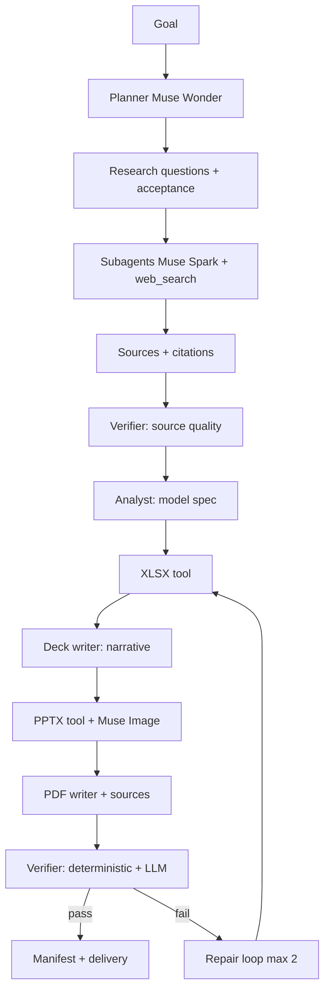
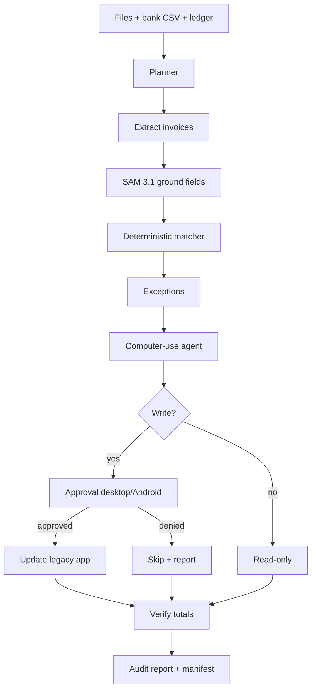
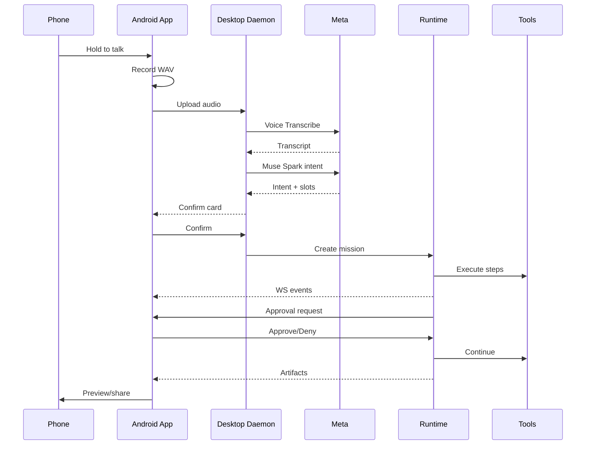
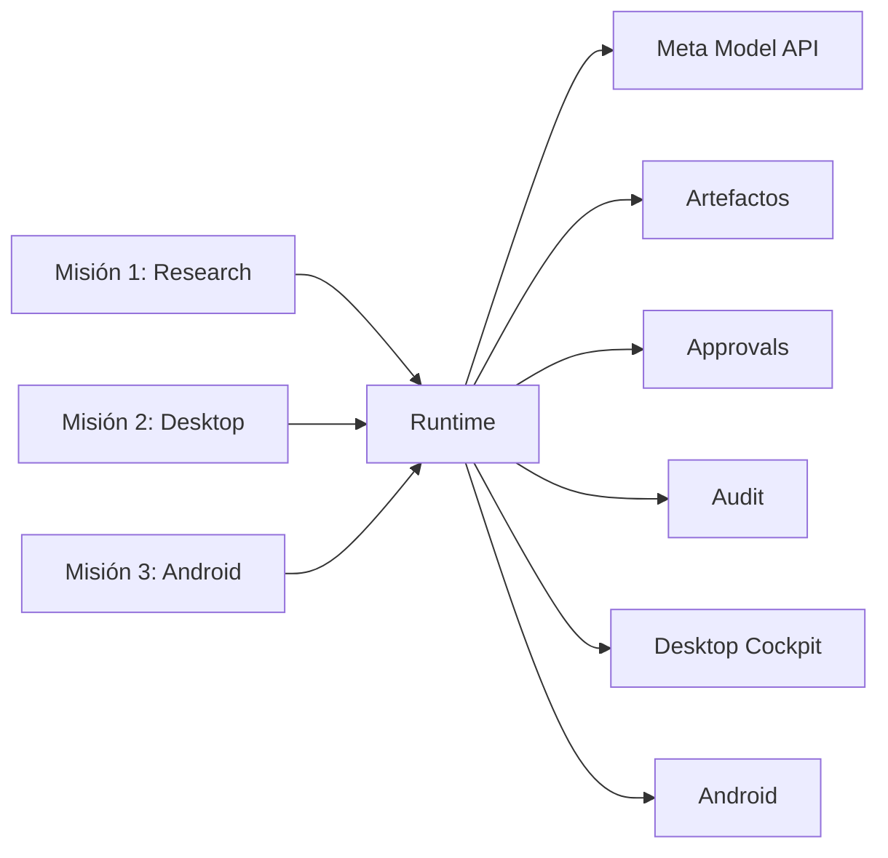

# Tres misiones complejas recomendadas

**Producto:** Orunex Mission Control  
**Principio:** las tres misiones comparten el mismo runtime, los mismos tools y las mismas superficies (desktop + Android). No son tres demos separadas; son tres pruebas de estrés del mismo sistema.

---

## Resumen ejecutivo

| # | Misión | Qué demuestra | Meta | Complejidad | Riesgo | Recomendación |
|---|---|---|---|---|---|---|
| 1 | **Consejo en 10 minutos** | Investigación → modelo → deck → PDF con citas | Muse Wonder, Muse Spark, Muse Image, web_search | Alta | Medio | **Héroe del demo** |
| 2 | **Auditor de escritorio** | Computer use real + reconciliación + approvals | Muse Wonder computer, Muse Spark, SAM 3.1 | Muy alta | Alto | **Wow técnico** |
| 3 | **Misión Bolsillo** | Android + voz + aprobaciones + artefactos | Voice Transcribe, Muse Spark, Muse Wonder | Alta | Medio | **Historia cross-platform** |

### Recomendación

Construir las tres sobre el mismo runtime, en este orden:

1. **Misión 1** primero: es la más confiable, la más visual y la que mejor comunica el valor.
2. **Misión 3** después: es la que demuestra que hay producto y no solo un script de escritorio.
3. **Misión 2** al final: es la más impresionante técnicamente, pero también la más frágil. Debe tener app de demo fija, video de respaldo y límites de seguridad.

Si el tiempo solo alcanza para una: **Misión 1 + Android básico**. Si alcanza para dos: **Misión 1 + Misión 3**. La Misión 2 es el “wow” que puede ganar el jurado, pero no debe comprometer la estabilidad del demo.

---

## Matriz de evaluación

Escala 1–5 (5 = mejor). “Esfuerzo” y “Riesgo” se interpretan como 5 = más esfuerzo/riesgo.

| Criterio | Misión 1 | Misión 2 | Misión 3 |
|---|---:|---:|---:|
| Impacto para el usuario | 5 | 5 | 4 |
| Ambición técnica | 4 | 5 | 4 |
| Profundidad de uso de Meta | 5 | 5 | 5 |
| Claridad para el jurado | 5 | 5 | 5 |
| Confiabilidad en vivo | 4 | 2 | 3 |
| Esfuerzo de implementación | 4 | 5 | 4 |
| Riesgo de demo | 3 | 5 | 4 |
| **Overall** | **9.0** | **8.5** | **8.5** |

**Lectura:** la Misión 1 es la mejor relación impacto/riesgo. La Misión 2 es la más ambiciosa y la que más impresiona si funciona. La Misión 3 es la que convierte el proyecto en producto.

---

# Misión 1 — “Consejo en 10 minutos”

## 1.1 Nombre y pitch

**Nombre interno:** `market_research` / **Research-to-Boardroom**.  
**Pitch:** “De una pregunta de negocio a un paquete para el consejo: investigación con fuentes, modelo financiero en Excel, deck de 12 slides y PDF ejecutivo, todo verificado.”

## 1.2 Historia de usuario

> “Soy director de estrategia. Necesito entender el mercado de energía solar distribuida en México y llevar una recomendación al consejo el lunes. Hoy tardo 3 días entre buscar fuentes, armar el Excel, diseñar el PPT y escribir el resumen. Quiero que Orunex me entregue el paquete completo y que yo solo revise y apruebe.”

## 1.3 Entrada

- Objetivo en lenguaje natural.
- Región / horizonte / audiencia / tono.
- Restricciones: número de fuentes, presupuesto, formato.
- Opcional: documentos internos (PDF/XLSX) para combinar con research público.

Ejemplo:

```text
Analiza el mercado de energía solar distribuida en México para 2026–2030.
Prepara un paquete para el consejo: 12 slides, modelo financiero en Excel,
resumen ejecutivo en PDF con citas. Público: CFO y board. Tono: conservador.
Máximo 12 fuentes primarias. Presupuesto: $2 USD.
```

## 1.4 Salidas

```text
missions/MIS-20261026-001/
├─ manifest.json
├─ research_notes.md
├─ sources.json
├─ market_model.xlsx
├─ board_deck.pptx
├─ executive_summary.pdf
├─ charts/
│  ├─ tam_sam_som.png
│  ├─ growth_scenarios.png
│  └─ unit_economics.png
└─ images/
   ├─ cover.png
   └─ section.png
```

### `research_notes.md`

- Preguntas de investigación.
- Hallazgos por pregunta.
- Fuente por hallazgo.
- Conflictos entre fuentes.
- Supuestos y vacíos.

### `sources.json`

```json
[
  {
    "id": "src_001",
    "url": "https://...",
    "title": "...",
    "publisher": "...",
    "published_at": "2026-...",
    "retrieved_at": "2026-10-26T...",
    "type": "primary|secondary",
    "snippet": "...",
    "content_hash": "sha256:...",
    "credibility": 0.86
  }
]
```

### `market_model.xlsx`

Hojas:

1. **Portada** — título, autor, fecha, alcance.
2. **Supuestos** — drivers, valores, fuente, sensibilidad.
3. **Mercado** — TAM/SAM/SOM, crecimiento, escenarios.
4. **Unit economics** — CAC, LTV, margen, payback.
5. **Escenarios** — base, optimista, conservador.
6. **Fuentes** — una fila por fuente, link y fecha.
7. **Dashboard** — charts y KPIs.

Requisitos:

- Fórmulas reales, no valores hardcodeados.
- Nombres definidos para supuestos.
- Formato condicional.
- Charts nativos de Excel.
- Cada supuesto tiene `source_id`.

### `board_deck.pptx`

Exactamente 12 slides:

1. Portada.
2. Pregunta y alcance.
3. Metodología y fuentes.
4. Mercado: tamaño y crecimiento.
5. Segmentos y clientes.
6. Competencia.
7. Modelo de negocio.
8. Unit economics.
9. Escenarios.
10. Riesgos.
11. Recomendación.
12. Próximos pasos / apéndice.

Requisitos:

- 16:9, master consistente.
- Paleta y tipografía de Orunex.
- Charts desde el Excel (no imágenes pegadas sin datos).
- 2–3 visuals de Muse Image (portada, sección, cierre), sin texto.
- Speaker notes.
- Sin placeholders, sin overflow.

### `executive_summary.pdf`

- 3–5 páginas.
- Resumen ejecutivo, hallazgos, recomendación, riesgos.
- Citas inline `[1]`, `[2]`.
- Bibliografía con URLs y fechas.
- Tabla de supuestos clave.

## 1.5 Flujo de la misión



### Paso a paso

1. **Plan (Muse Wonder)**
   - Descompone en 6–10 research questions.
   - Define 4 deliverables y criterios de aceptación.
   - Estima presupuesto y tiempo.
2. **Research (Muse Spark + `web_search`)**
   - 3–5 subagentes en paralelo, cada uno con 2–3 preguntas.
   - `tools=[{"type":"web_search"}]` y `include=["web_search_call.results"]`.
   - Extrae `url_citation` de `output_text.annotations`.
   - Guarda `sources.json`.
   - Para preguntas que requieren interacción, `browser.act` con Playwright.
3. **Source verification (Muse Spark)**
   - Prioriza fuentes primarias: gobiernos, reguladores, reportes de industria, estados financieros.
   - Detecta fuentes duplicadas, fechas viejas, conflictos.
   - Asigna credibilidad y marca claims no soportados.
4. **Model spec (Muse Wonder)**
   - Define supuestos, fórmulas, escenarios.
   - Cada supuesto referencia `source_id` o se marca como “estimación Orunex”.
5. **Excel (`docs.xlsx`)**
   - openpyxl: fórmulas, nombres, charts, formato.
   - Valida que las fórmulas calculen (con `formulas` library o recálculo simbólico).
6. **Deck (Muse Wonder + `docs.pptx`)**
   - Narrativa de 12 slides.
   - Charts desde el modelo.
   - Muse Image para portada/sección.
7. **PDF (Muse Spark + `docs.pdf`)**
   - Resumen ejecutivo con citas.
   - Bibliografía.
8. **Verification**
   - Determinista: 12 slides, archivos abren, fórmulas, citas, números.
   - LLM: coherencia, tono, completitud, contradicciones.
9. **Delivery**
   - Manifest, zip, evento `mission.completed`.
   - Desktop y Android reciben artifacts.

## 1.6 Uso de Meta

| Etapa | Modelo / tool | Por qué |
|---|---|---|
| Plan | `muse-wonder-1.0` | Long-horizon, tool use, estructura |
| Research | `muse-spark-1.3` + `web_search` | Cost-efficient, citas nativas |
| Source check | `muse-spark-1.3` | Clasificación y consistencia |
| Model spec | `muse-wonder-1.0` | Razonamiento financiero |
| Deck | `muse-wonder-1.0` | Síntesis narrativa |
| Visuals | `muse-image-1.0` | Imágenes de marca |
| PDF | `muse-spark-1.3` | Redacción ejecutiva |
| Verify | `muse-spark-1.3` | Chequeo semántico |

**Ventaja:** no hay que construir un pipeline de RAG ni un scraper de búsqueda; Meta `web_search` devuelve citas y resultados crudos. Se complementa con Playwright solo para páginas que requieren interacción.

## 1.7 Por qué es compleja

- 10–15 pasos, 5+ tools, 3 artefactos interdependientes.
- Consistencia numérica entre Excel, PPT y PDF.
- Citas verificables, no “fuentes inventadas”.
- Manejo de conflictos y datos faltantes.
- Verificación determinista + semántica.
- Presupuesto y tiempo acotados.

## 1.8 Demo (2 minutos)

1. Escribir el goal.
2. Mostrar el plan y las research questions.
3. Mostrar citas de Meta web_search.
4. Abrir Excel: una fórmula y su fuente.
5. Abrir PPT: portada con Muse Image, slide de mercado, slide de recomendación.
6. Abrir PDF: bibliografía.
7. “Cada número tiene un origen; cada fuente es verificable.”

## 1.9 Criterios de aceptación

- [ ] 10–12 fuentes, 80%+ de claims con cita.
- [ ] 12 slides exactos, sin placeholders.
- [ ] Excel con 6+ hojas, fórmulas, charts y hoja de fuentes.
- [ ] Números del deck coinciden con el Excel.
- [ ] PDF con bibliografía y citas inline.
- [ ] Verificación pasa; si no, repair loop documentado.
- [ ] Tiempo < 10 min; costo < $2.
- [ ] Funciona con `FIXTURE_MODE=1`.

## 1.10 Esfuerzo y riesgo

- **Esfuerzo:** 4–5 días (planner 1, research 1, Excel 1, PPT 1, PDF/verify 1).
- **Riesgo:** medio.
- **Mayor riesgo:** consistencia de datos y calidad de fuentes.
- **Mitigación:** fixtures, schema estricto, verifier determinista, no usar una sola llamada para multi-hop.

## 1.11 Variantes para el demo

- **Energía solar en México** (impacto local, datos públicos).
- **Market entry de un SaaS para pymes** (más fácil de fictionalizar).
- **Industria del agave/tequila** (visual, cultural, datos exportables).
- **Ciberseguridad para pymes** (riesgo, actualidad).

Recomendación: elegir un tema con datos públicos y una historia clara; evitar temas que dependan de datos privados o de pago.

---

# Misión 2 — “Auditor de escritorio”

## 2.1 Nombre y pitch

**Nombre interno:** `reconciliation` / **Desktop Auditor**.  
**Pitch:** “Orunex abre la aplicación legacy, lee las facturas, las concilia contra el banco, marca las discrepancias y actualiza el libro mayor solo con tu aprobación.”

## 2.2 Historia de usuario

> “Soy controller de una pyme. Cada mes recibo 20 facturas en PDF, un CSV del banco y un libro mayor en Excel. Conciliar todo a mano me toma un día. Además, el ERP viejo no tiene API. Quiero que Orunex haga la conciliación, me muestre las excepciones y actualice el ERP después de que yo apruebe.”

## 2.3 Entrada

- Carpeta con facturas PDF/imagen.
- CSV del banco.
- Excel del libro mayor.
- App legacy de demo (`Legacy Invoice Manager`) o Excel desktop.
- Reglas de negocio: tolerancia, moneda, proveedores.

## 2.4 Salidas

```text
missions/MIS-20261027-002/
├─ reconciliation.xlsx
├─ audit_report.pdf
├─ exceptions.csv
├─ ledger_updated.xlsx
├─ action_trace.jsonl
└─ screenshots/
```

### `reconciliation.xlsx`

- Hoja `Matches`: factura ↔ transacción, confianza, evidencia.
- Hoja `Exceptions`: faltantes, duplicados, montos, fechas, proveedores.
- Hoja `Ledger`: estado antes/después.
- Hoja `Summary`: totales, diferencias, estado.

### `audit_report.pdf`

- Resumen.
- Metodología.
- Tabla de excepciones.
- Acciones recomendadas.
- Evidencia (IDs, screenshots).
- Aprobaciones y timestamps.

## 2.5 Flujo



### Paso a paso

1. **Plan (Muse Wonder)**
   - Inventario de archivos.
   - Definir matching rules y tolerancias.
   - Definir acceptance criteria.
2. **Extraction (Muse Spark + SAM 3.1)**
   - PDFs con texto: extracción directa.
   - Imágenes/escaneos: Muse Spark vision + SAM para localizar campos.
   - Normalizar: proveedor, RFC, folio, fecha, subtotal, IVA, total, moneda.
   - Confidence score por campo.
3. **Matching determinista**
   - Match exacto por folio + monto.
   - Fuzzy por proveedor/fecha/monto.
   - Detectar duplicados, pagos parciales, notas de crédito.
   - Tolerancia configurable (±$0.01, ±1 día).
4. **Computer use (Muse Wonder)**
   - Abrir app legacy.
   - Filtrar facturas pendientes.
   - Leer estado actual.
   - Preparar cambios (no escribir aún).
5. **Approval**
   - Mostrar resumen: “3 facturas, $12,450, 2 discrepancias”.
   - Desktop modal + Android card.
   - Aprobar/denegar con evidencia.
6. **Write**
   - Solo las filas aprobadas.
   - Una acción a la vez; screenshot después de cada una.
   - Si falla, rollback o marcar para revisión.
7. **Verify**
   - Releer el ledger.
   - Sumas de control.
   - Reporte de auditoría.
8. **Deliver**
   - Excel, PDF, trace, screenshots.

## 2.6 App legacy de demo

Para que el demo sea confiable, construir una app Windows pequeña `Legacy Invoice Manager`:

- Tkinter o PySide6.
- Tabla de facturas con columnas: Folio, Proveedor, Fecha, Monto, Estado.
- Botones: “Filtrar pendientes”, “Editar”, “Guardar”.
- Diálogo de edición con campos.
- Datos de fixture.
- Look “viejo” pero estable.
- Sin dependencia de red.

Ventajas:

- Layout conocido.
- Coordenadas estables.
- Podemos forzar errores para demostrar recuperación.
- No arriesgamos datos reales.

Alternativa: Excel desktop con una hoja de ledger. Más real, pero menos control.

## 2.7 Uso de Meta

| Etapa | Modelo / tool | Por qué |
|---|---|---|
| Plan | `muse-wonder-1.0` | Long-horizon + tools |
| Extracción | `muse-spark-1.3` | Vision/JSON |
| Grounding | `sam-3.1` | Cajas/máscaras de campos |
| Computer use | `muse-wonder-1.0` + `computer` | Observe-act loop |
| Verify | `muse-spark-1.3` | Consistencia |
| Reporte | `muse-spark-1.3` | Redacción |

## 2.8 Por qué es compleja

- Computer use real con screenshots y acciones.
- Visión + OCR + normalización.
- Matching con ambigüedad.
- Acciones de escritura con riesgo.
- Rollback y auditoría.
- Safety checks del modelo y approvals humanos.

## 2.9 Demo (2 minutos)

1. Mostrar carpeta de facturas y CSV.
2. Lanzar misión.
3. Ver extracción y matching en timeline.
4. Ver la app legacy abrirse y el agente navegar.
5. Llegar a la escritura; approval en Android.
6. Aprobar; ver filas actualizadas.
7. Abrir reporte con 3 discrepancias.
8. “Cero escrituras sin aprobación; todo auditado.”

## 2.10 Criterios de aceptación

- [ ] Extracción ≥95% de campos en fixtures.
- [ ] 20 facturas conciliadas en <5 min.
- [ ] 3 discrepancias detectadas correctamente.
- [ ] 0 escrituras sin approval.
- [ ] Rollback o marca de revisión si falla una escritura.
- [ ] Audit trace con screenshots.
- [ ] Kill switch funciona.
- [ ] App demo corre en Windows 11.

## 2.11 Esfuerzo y riesgo

- **Esfuerzo:** 5–6 días.
- **Riesgo:** alto.
- **Mayor riesgo:** computer use frágil, DPI, foco de ventanas, latencia.
- **Mitigación:** app demo fija, UIA fallback, max steps, pausa con mouse, video de respaldo, no usar apps reales en vivo.

---

# Misión 3 — “Misión Bolsillo”

## 3.1 Nombre y pitch

**Nombre interno:** `mobile_command` / **Pocket Mission Control**.  
**Pitch:** “Ordénale desde el teléfono. Orunex ejecuta en tu escritorio, te muestra el progreso, te pide aprobación y te entrega los archivos en la mano.”

## 3.2 Historia de usuario

> “Voy caminando a una reunión. Necesito el reporte de ventas de octubre. Abro Orunex en el teléfono, mantengo el micrófono y digo: ‘Prepara el reporte de ventas de octubre y envíamelo’. El agente corre en mi PC, me pide aprobación para escribir en el ERP y me entrega el PPT y el PDF.”

## 3.3 Entrada

- Comando de voz o texto en Android.
- Archivos opcionales (foto de recibo, PDF).
- Misión existente o nueva.

## 3.4 Salidas

- Transcripción.
- Intención confirmada.
- Misión creada.
- Timeline en vivo.
- Approval card.
- Artefactos descargables/previsualizables.
- Notificación.

## 3.5 Flujo



### Paso a paso

1. **Pairing**
   - QR en desktop.
   - Android escanea.
   - Confirmación de 6 dígitos.
   - JWT + refresh.
2. **Captura de voz**
   - Android graba WAV mono 16/24 kHz.
   - Sube a `/voice/transcribe` o usa WebSocket realtime.
   - Muse Voice Transcribe devuelve transcript.
3. **Intención**
   - Muse Spark extrae `{action, subject, timeframe, format, risk}`.
   - Si falta algo, pregunta.
4. **Confirmación**
   - Android muestra: “Crear reporte de ventas de octubre y enviarlo”.
   - Botón “Ejecutar”.
5. **Misión**
   - Desktop runtime ejecuta Misión 1/2.
   - Eventos por WebSocket.
6. **Approval**
   - Si el step es `dangerous`, se pausa.
   - Android muestra acción, evidencia, riesgo.
   - Aprobar con PIN/biometría.
7. **Artefactos**
   - Descarga/preview.
   - Compartir.
   - Notificación.

## 3.6 Uso de Meta

| Etapa | Modelo / tool | Por qué |
|---|---|---|
| Transcripción | `muse-voice-transcribe-1.0` | Voz en español |
| Intención | `muse-spark-1.3` | JSON rápido |
| Misión | `muse-wonder-1.0` | Ejecución |
| Visuals | `muse-image-1.0` | Reporte |
| Cámara | `sam-3.1` | Recibos/documentos |

## 3.7 Por qué es compleja

- Estado distribuido desktop ↔ Android.
- WebSocket + reconexión + replay.
- Pairing y seguridad.
- Voz + audio formats.
- Approvals con evidencia.
- Preview de artefactos en Android.
- Offline/queue.

## 3.8 Demo (1.5 minutos)

1. Mostrar QR y pairing.
2. Hablar al teléfono.
3. Ver transcripción.
4. Confirmar.
5. Ver timeline en desktop y Android.
6. Aprobar una acción.
7. Abrir PPT en el teléfono.
8. “El escritorio ejecuta; el teléfono controla.”

## 3.9 Criterios de aceptación

- [ ] Pairing <30 s.
- [ ] Comando → primer evento <2 s en LAN.
- [ ] Transcripción usable en español.
- [ ] Reconexión tras perder red.
- [ ] Approval obligatorio para `dangerous`.
- [ ] Artifact preview/download.
- [ ] Token revocable.
- [ ] Sin API key de Meta en el teléfono.

## 3.10 Esfuerzo y riesgo

- **Esfuerzo:** 4 días.
- **Riesgo:** medio.
- **Mayor riesgo:** Android build + networking + audio.
- **Mitigación:** emulador desde D1, pairing simple, texto como fallback, WebSocket con replay.

---

# Cómo se conectan las tres misiones



- **Misión 1** prueba el runtime de investigación y artefactos.
- **Misión 2** prueba computer use, visión y seguridad.
- **Misión 3** prueba la capa distribuida y la experiencia móvil.
- Las tres usan el mismo `Mission`, `Step`, `Artifact`, `Approval` y `Event`.
- El jurado ve un producto coherente, no tres prototipos.

---

# Recomendación final de alcance

## Si hay 10 días y 1 developer

1. Días 1–4: Misión 1.
2. Días 5–6: Desktop.
3. Días 7–8: Android + Misión 3.
4. Días 9–10: Misión 2 como “lab” + hardening + demo.

## Si hay 10 días y 2 developers

- Developer A: core + Misión 1 + Misión 2.
- Developer B: desktop + Android + Misión 3.
- Integración diaria; demo el D9.

## Si el tiempo se reduce a 5 días

- Misión 1 + desktop + Android read-only.
- Computer use se muestra con video grabado.
- No intentar Misión 2 en vivo.

## Lo que no se debe sacrificar

- Approvals.
- Auditoría.
- Verificación de artefactos.
- Modo fixture.
- Video de respaldo.
- README y setup reproducible.

---

# Apéndice: prompts de referencia

## Planner (Muse Wonder)

```text
Eres el planner de Orunex. Convierte el objetivo del usuario en un DAG
verificable. Usa solo las tools registradas. Cada deliverable debe tener
criterios de aceptación comprobables. Si falta información crítica,
devuelve needs_clarification con preguntas concretas.

Objetivo: {goal}
Adjuntos: {files}
Presupuesto: {budget}
Riesgo permitido: {risk_profile}

Devuelve JSON con:
- summary
- assumptions[]
- steps[] {id,title,tool,args,depends_on,acceptance,risk}
- deliverables[]
- verification[]
```

## Research subagent (Muse Spark + web_search)

```text
Investiga la pregunta: {question}
Usa web_search. Prioriza fuentes primarias y publicadas en los últimos
24 meses. Para cada hallazgo, devuelve:
- claim
- evidencia (cita textual corta)
- url
- fecha
- tipo de fuente
- confianza (0-1)
No inventes URLs. Si no encuentras evidencia, dilo.
```

## Verifier (Muse Spark)

```text
Eres el verificador de Orunex. Revisa los artefactos contra el objetivo
y los criterios de aceptación. Devuelve:
- pass/fail por criterio
- evidencia
- contradicciones
- números sin fuente
- placeholders
- recomendación de reparación
No apruebes si falta evidencia.
```

## Computer use instructions

```text
Eres un agente de computer use operando una app de escritorio.
Coordenadas en píxeles de la última screenshot. Haz clic en el centro.
Devuelve lotes cortos solo si no dependen de feedback visual.
No escribas ni borres sin aprobación. Si no puedes completar la tarea,
explica por qué y detente. No adivines estados ocultos.
```
